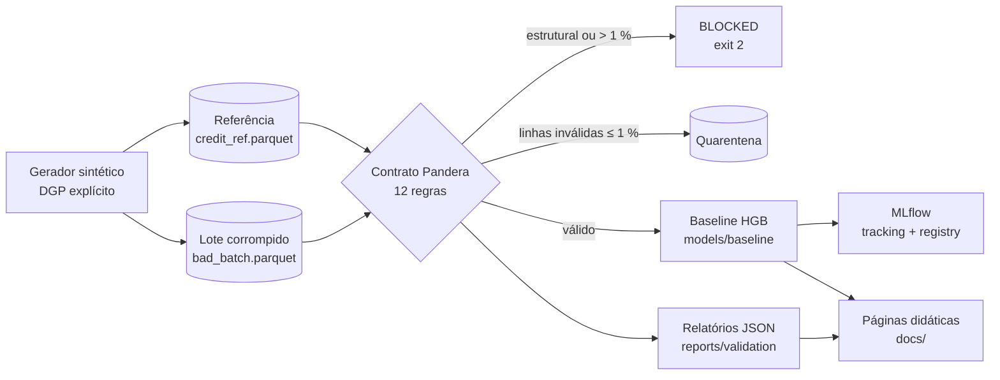

# Credit Sentinel — Tech Challenge Fase 4 (FIAP MLET)


> **Vídeo STAR (5 min):** *link publicado na release `v1.0.0-ga`.*
> **Páginas didáticas:** [índice das releases](docs/index.html) ·
> [Etapa 1 — contratos de dados](docs/releases/etapa-1-contratos.html)
> (também no GitHub Pages: <https://humbertosena.github.io/fiap-fase4-tech-challenge/>).

## 1. Resumo executivo

Uma fintech fictícia de crédito tem um modelo de *credit scoring* em produção. Com
inflação, juros altos e novos perfis de clientes, a diretoria suspeita de
**degradação silenciosa**: o modelo continua respondendo, mas decide pior. Este
repositório constrói a **camada de sustentação e confiabilidade** desse modelo:

1. **Barreira de qualidade na ingestão:** contrato de dados Pandera com 12 regras e
   *circuit breaker* que bloqueia lotes corrompidos (Etapa 1).
2. **Diagnóstico de degradação:** simulação de crise em três janelas mensais e
   detecção estatística de *drift* com KS, PSI e Evidently (Etapa 2).
3. **Observabilidade:** logs JSON, Data SLOs com *error budget*, alertas e MLflow
   (Etapa 3).
4. **Governança:** LGPD, auditoria de fairness e análise causal (Etapa 4).

Todos os dados são **sintéticos** (ADR 001); nenhum dado pessoal real é usado.

### Estado atual

| Etapa | Tema | Release | Status | Página |
| :--- | :--- | :--- | :--- | :--- |
| 1 | Validação de dados e contratos | `v0.1.0-alpha` | ✅ concluída | [etapa-1-contratos.html](docs/releases/etapa-1-contratos.html) |
| 2 | Simulação e detecção de drift | `v0.2.0-beta` | ⏳ planejada | — |
| 3 | Observabilidade de pipelines e modelos | `v0.3.0-rc` | ⏳ planejada | — |
| 4 | Governança (LGPD) e vídeo STAR | `v1.0.0-ga` | ⏳ planejada | — |

## 2. Arquitetura



O pacote `credit_sentinel` (em `src/`) é organizado por capacidade, e cada subpacote
expõe seus subcomandos na CLI `credit-sentinel`:

| Subpacote | Responsabilidade | Release |
| :--- | :--- | :--- |
| `data` | Gerador sintético, lote corrompido, dicionário de dados | v0.1.0-alpha |
| `contracts` | Schema Pandera, circuit breaker, sanitizador de PII, export YAML | v0.1.0-alpha |
| `ml` | Features, treino, métricas, limiares, model card, MLflow | v0.1.0-alpha |
| `explainers` | Páginas HTML didáticas autocontidas | uma por release |
| `drift`, `observability`, `tracking`, `governance` | Etapas 2 a 4 | próximas releases |

## 3. Guia de reprodução

Pré-requisitos: Python 3.12, [uv](https://docs.astral.sh/uv/) ≥ 0.12 e, opcionalmente,
Docker (MLflow em container).

```bash
git clone https://github.com/humbertosena/fiap-fase4-tech-challenge.git
cd fiap-fase4-tech-challenge
cp .env.example .env                 # troque CS_PII_SALT antes de qualquer uso real
make setup                           # uv sync --all-groups + validação do ambiente
make lint test                       # ruff estrito + pytest
make data                            # referência (12.000) + lote corrompido (600), bit a bit iguais
make validate                        # referência aprovada; lote corrompido BLOCKED (exit 2)
make train                           # valida, treina e registra o baseline no MLflow
make explainers                      # gera docs/index.html e docs/releases/*.html
make mlflow                          # MLflow UI em http://localhost:5001
```

Tempos aproximados em um MacBook (Apple Silicon): `make setup` ≈ 1 min na primeira vez,
`make data` ≈ 2 s, `make train` ≈ 10 s, suíte de testes ≈ 20 s.

Alternativa ao `make mlflow`: `docker compose up -d mlflow` sobe o mesmo servidor na
porta 5001 (a 5000 é usada pelo AirPlay no macOS), lendo o mesmo `mlruns/`.

| Comando da CLI | Efeito | Exit code |
| :--- | :--- | :--- |
| `credit-sentinel generate-data [--force]` | gera os datasets e `docs/data_dictionary.md` | 0, ou 1 se a referência já existir sem `--force` |
| `credit-sentinel validate --input <parquet> [--schema reference]` | valida um lote e grava `reports/validation/<lote>_report.json` | 0 aprovado · 2 bloqueado |
| `credit-sentinel train [--no-mlflow]` | treina o baseline e atualiza o model card | 0, ou 2 se a referência violar o contrato |
| `credit-sentinel scan-pii <caminhos…>` | procura CPF, e-mail, telefone e ids em claro | 0 limpo · 1 achados |
| `credit-sentinel export-contract` | exporta `config/data_contract.yaml` | 0 |
| `credit-sentinel build-explainers [--etapa 1]` | gera as páginas didáticas | 0 |

## 4. Etapa 1 — Validação de dados e contratos

### 4.1 Dataset de referência

`data/reference/credit_ref.parquet`: 12.000 propostas (jul/2025 a jun/2026), 18
colunas, taxa base de inadimplência de 6,45 %, SHA-256
`cb41f7d3b239c3ea43e100f478ef8975c6c815abbcf1f89ad018b2f2a4224ec4`. O processo gerador
está no [ADR 001](docs/adr/001-dataset-sintetico.md) e as colunas no
[dicionário de dados](docs/data_dictionary.md). O
[notebook de EDA](notebooks/01_eda_and_data_quality.ipynb) traz o diagnóstico ICRA.

### 4.2 Contrato de dados (Pandera)

O contrato tem 12 regras, quatro vezes o mínimo de 3 pedido pelo enunciado. Está em
`src/credit_sentinel/contracts/schema.py` e é exportado para
[`config/data_contract.yaml`](config/data_contract.yaml) (ADR 002).

| Regra | Dimensão ICRA | Descrição | Severidade |
| :--- | :--- | :--- | :--- |
| R01 | Integridade | Schema estrito: colunas exatas (`strict=True`) e tipos exatos (`coerce=False`) | estrutural |
| R02 | Unicidade | `id_cliente` único, não nulo e no formato `CLI-` + 10 hexadecimais | estrutural |
| R03 | Completude | Renda, score, idade e endividamento sem nulos | linha |
| R04 | Acurácia | Idade entre 18 e 100 anos | linha |
| R05 | Acurácia | Renda mensal positiva e até R$ 1.000.000 | linha |
| R06 | Acurácia | Score de bureau entre 0 e 1000 | linha |
| R07 | Acurácia | Endividamento e utilização de crédito entre 0 e 1 | linha |
| R08 | Acurácia | Categorias nos domínios; prazo e alvo nos valores válidos | linha |
| R09 | Razoabilidade | Valores positivos; tempo de emprego e atrasos em faixas plausíveis | linha |
| R10 | Consistência | Parcela não excede a renda | linha |
| R11 | Consistência | Desempregado não tem tempo de emprego | linha |
| R12 | Consistência | Tempo de emprego compatível com a idade (a partir dos 16 anos) | linha |

**Circuit breaker em dois níveis:** violações estruturais bloqueiam o lote; violações
de linha vão para a quarentena (`data/quarantine/<run_id>.parquet`) enquanto forem até
1 % do lote; acima disso o breaker abre. Nunca há imputação silenciosa, e o inventário
é sempre completo (`lazy=True`).

### 4.3 Prova de bloqueio do lote corrompido

O lote `data/corrupted/bad_batch.parquet` (600 linhas) recebe dez anomalias
propositais, inclusive uma coluna `cpf` fictícia:

```console
$ uv run credit-sentinel validate --input data/corrupted/bad_batch.parquet
lote: bad_batch (600 linhas)
schema: credit_scoring_inference
decisão: BLOCKED — violação estrutural (R01, R02): lote bloqueado
regra  coluna                   falhas  check
R01    cpf                           1  column_in_schema
R01    score_bureau                 18  dtype('int64')
R02    id_cliente                   36  field_uniqueness
R02    id_cliente                    6  not_nullable
R03    renda_mensal                 24  not_nullable
R03    score_bureau                 18  not_nullable
R04    idade                        30  R04 · idade fora da faixa
R07    taxa_endividamento           12  R07 · taxa_endividamento fora da faixa
R08    situacao_emprego             18  R08 · situacao_emprego fora do domínio
R10    —                            12  R10 · valor_parcela <= renda_mensal
R11    —                             6  R11 · situacao_emprego == 'desempregado' => tempo_emprego_meses == 0
rejeitadas: 162 (27.00%) · válidas: 438
relatório: reports/validation/bad_batch_report.json
```

Relatórios completos em [`reports/validation/`](reports/validation/). As amostras de
falha trazem apenas `id_cliente_hash` (HMAC-SHA-256 com salt secreto), e
`credit-sentinel scan-pii reports docs` confirma que não há dado pessoal em claro.

### 4.4 Modelo baseline

`HistGradientBoostingClassifier` em `Pipeline` sklearn, com 14 features, sem
`genero`/`regiao` (ADR 003, [model card](docs/model_card.md)). O treino só acontece
depois que a referência passa pelo contrato.

| Métrica (validação, 2.400 propostas) | Valor | Critério |
| :--- | ---: | :--- |
| ROC-AUC | 0,829 | ≥ 0,80 |
| Brier | 0,052 | ≤ 0,06 |
| KS | 0,541 | ≥ 0,45 |
| F1 no limiar 0,125 | 0,383 | — |

Top-3 features por importância de permutação: `score_bureau`,
`qtd_parcelas_atraso_12m` e `utilizacao_credito`. O modelo é registrado no MLflow como
`credit-scoring-model` (experimento `credit-sentinel/baseline`) com assinatura de 14
colunas de entrada.

## Próximas seções (releases seguintes)

5. Etapa 2 — drift · 6. Etapa 3 — observabilidade · 7. Governança e LGPD ·
8. Análise causal da degradação · 9. Runbook · 10. Roteiro STAR ·
11. Decisões, estrutura e rastreabilidade · 12. Agradecimentos e transparência.

## Decisões de arquitetura

- [ADR 001 — Dataset sintético com processo gerador explícito](docs/adr/001-dataset-sintetico.md)
- [ADR 002 — Contrato Pandera com circuit breaker em dois níveis](docs/adr/002-pandera-circuit-breaker.md)
- [ADR 003 — Modelo baseline com HistGradientBoosting](docs/adr/003-modelo-baseline-hgb.md)

## Licença

Distribuído sob a licença MIT. Consulte [LICENSE](LICENSE).
