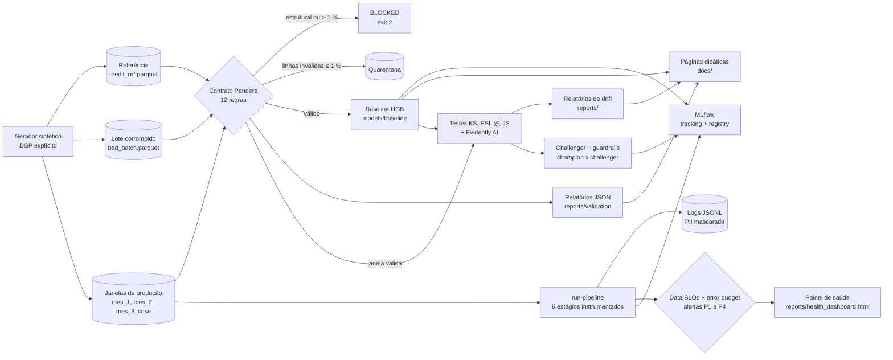

# Credit Sentinel — Tech Challenge Fase 4 (FIAP MLET)


> **Vídeo STAR (5 min):** *link publicado na release `v1.0.0-ga`.*
> **Páginas didáticas:** [índice das releases](docs/index.html) ·
> [Etapa 1 — contratos de dados](docs/releases/etapa-1-contratos.html) ·
> [Etapa 2 — drift](docs/releases/etapa-2-drift.html) ·
> [Etapa 3 — observabilidade](docs/releases/etapa-3-observabilidade.html)
> (também no GitHub Pages: <https://humbertosena.github.io/fiap-fase4-tech-challenge/>).

## 1. Resumo executivo

Uma fintech fictícia de crédito tem um modelo de *credit scoring* em produção. Com
inflação, juros altos e novos perfis de clientes, a diretoria suspeita de
**degradação silenciosa**: o modelo continua respondendo, mas decide pior. Este
repositório constrói a **camada de sustentação e confiabilidade** desse modelo:

1. **Barreira de qualidade na ingestão:** contrato de dados Pandera com 12 regras e
   *circuit breaker* que bloqueia lotes corrompidos (Etapa 1).
2. **Diagnóstico de degradação:** simulação de crise em três janelas mensais e
   detecção estatística de *drift* com KS, PSI e Evidently (Etapa 2).
3. **Observabilidade:** logs JSON, Data SLOs com *error budget*, alertas e MLflow
   (Etapa 3).
4. **Governança:** LGPD, auditoria de fairness e análise causal (Etapa 4).

Todos os dados são **sintéticos** (ADR 001); nenhum dado pessoal real é usado.

### Estado atual

| Etapa | Tema | Release | Status | Página |
| :--- | :--- | :--- | :--- | :--- |
| 1 | Validação de dados e contratos | `v0.1.0-alpha` | ✅ concluída | [etapa-1-contratos.html](docs/releases/etapa-1-contratos.html) |
| 2 | Simulação e detecção de drift | `v0.2.0-beta` | ✅ concluída | [etapa-2-drift.html](docs/releases/etapa-2-drift.html) |
| 3 | Observabilidade de pipelines e modelos | `v0.3.0-rc` | ✅ concluída | [etapa-3-observabilidade.html](docs/releases/etapa-3-observabilidade.html) |
| 4 | Governança (LGPD) e vídeo STAR | `v1.0.0-ga` | 🚧 em andamento | — |

## 2. Arquitetura



O pacote `credit_sentinel` (em `src/`) é organizado por capacidade, e cada subpacote
expõe seus subcomandos na CLI `credit-sentinel`:

| Subpacote | Responsabilidade | Release |
| :--- | :--- | :--- |
| `data` | Gerador sintético, lote corrompido, dicionário de dados | v0.1.0-alpha |
| `contracts` | Schema Pandera, circuit breaker, sanitizador de PII, export YAML | v0.1.0-alpha |
| `ml` | Features, treino, métricas, limiares, model card, MLflow, retreino do challenger e guardrails | v0.1.0-alpha e v0.3.0-rc |
| `drift` | Simulação das janelas, testes de drift, predições por janela, Evidently | v0.2.0-beta |
| `explainers` | Páginas HTML didáticas autocontidas | uma por release |
| `observability` | Logger JSON com PII mascarada, Data SLOs, alertas, pipeline e painel de saúde | v0.3.0-rc |
| `tracking` | Hook do MLflow por janela, Model Registry com aliases `champion` e `challenger` | v0.3.0-rc |
| `governance` | Auditoria de fairness por subgrupos (`fairness-audit`), também usada no G4 do retreino | v0.3.0-rc e v1.0.0-ga |

## 3. Guia de reprodução

Pré-requisitos: Python 3.12, [uv](https://docs.astral.sh/uv/) ≥ 0.12 e, opcionalmente,
Docker (MLflow em container).

```bash
git clone https://github.com/humbertosena/fiap-fase4-tech-challenge.git
cd fiap-fase4-tech-challenge
cp .env.example .env                 # troque CS_PII_SALT antes de qualquer uso real
make setup                           # uv sync --all-groups + validação do ambiente
make lint test                       # ruff estrito + pytest
make data                            # referência (12.000) + lote corrompido (600), bit a bit iguais
make validate                        # referência aprovada; lote corrompido BLOCKED (exit 2)
make train                           # valida, treina e registra o baseline no MLflow
make simulate                        # três janelas de produção (5.000 linhas cada)
make drift                           # testes de drift, scores e relatórios do Evidently
make pipeline                        # logs, Data SLOs, alertas, painel de saúde e runs no MLflow
make explainers                      # gera docs/index.html e docs/releases/*.html
make mlflow                          # MLflow UI em http://localhost:5001
```

Tempos aproximados em um MacBook (Apple Silicon): `make setup` ≈ 1 min na primeira vez,
`make data` ≈ 2 s, `make train` ≈ 10 s, `make simulate` ≈ 3 s, `make drift` ≈ 6 s, `make pipeline` ≈ 7 s, suíte de testes ≈ 2 min.

Alternativa ao `make mlflow`: `docker compose up -d mlflow` sobe o mesmo servidor na
porta 5001 (a 5000 é usada pelo AirPlay no macOS), lendo o mesmo `mlruns/`.

| Comando da CLI | Efeito | Exit code |
| :--- | :--- | :--- |
| `credit-sentinel generate-data [--force]` | gera os datasets e `docs/data_dictionary.md` | 0, ou 1 se a referência já existir sem `--force` |
| `credit-sentinel validate --input <parquet> [--schema reference]` | valida um lote e grava `reports/validation/<lote>_report.json` | 0 aprovado · 2 bloqueado |
| `credit-sentinel train [--no-mlflow]` | treina o baseline e atualiza o model card | 0, ou 2 se a referência violar o contrato |
| `credit-sentinel simulate [--windows a,b] [--force]` | gera `data/production/<janela>.parquet` e imprime os deslocamentos | 0, ou 1 se a janela já existir sem `--force` |
| `credit-sentinel detect-drift [--window all\|<janela>]` | valida a janela, roda os testes de drift e o Evidently, grava `reports/` | 0 · 2 se o contrato bloquear a janela |
| `credit-sentinel run-pipeline [--window all\|<janela>] [--quick] [--strict] [--no-mlflow]` | executa os 6 estágios por janela, avalia os SLOs e grava `reports/slo_audit_report.json`, `reports/health_dashboard.html` e `logs/` | 0 · 2 com `--strict` se alguma janela for bloqueada |
| `credit-sentinel retrain-challenger [--promote] [--no-mlflow]` | retreina o challenger, avalia os 5 guardrails, registra a versão `@challenger` | 0 aprovado · 3 reprovado |
| `credit-sentinel promote-challenger` | promove o challenger registrado a `@champion` (exige guardrails aprovados) | 0 · 3 recusado · 1 sem relatório do challenger atual |
| `credit-sentinel scan-pii <caminhos…>` | procura CPF, e-mail, telefone e ids em claro | 0 limpo · 1 achados |
| `credit-sentinel export-contract` | exporta `config/data_contract.yaml` | 0 |
| `credit-sentinel build-explainers [--etapa 1,2]` | gera as páginas didáticas | 0 |

## 4. Etapa 1 — Validação de dados e contratos

### 4.1 Dataset de referência

`data/reference/credit_ref.parquet`: 12.000 propostas (jul/2025 a jun/2026), 18
colunas, taxa base de inadimplência de 6,45 %, SHA-256
`cb41f7d3b239c3ea43e100f478ef8975c6c815abbcf1f89ad018b2f2a4224ec4`. O processo gerador
está no [ADR 001](docs/adr/001-dataset-sintetico.md) e as colunas no
[dicionário de dados](docs/data_dictionary.md). O
[notebook de EDA](notebooks/01_eda_and_data_quality.ipynb) traz o diagnóstico ICRA.

### 4.2 Contrato de dados (Pandera)

O contrato tem 12 regras, quatro vezes o mínimo de 3 pedido pelo enunciado. Está em
`src/credit_sentinel/contracts/schema.py` e é exportado para
[`config/data_contract.yaml`](config/data_contract.yaml) (ADR 002).

| Regra | Dimensão ICRA | Descrição | Severidade |
| :--- | :--- | :--- | :--- |
| R01 | Integridade | Schema estrito: colunas exatas (`strict=True`) e tipos exatos (`coerce=False`) | estrutural |
| R02 | Unicidade | `id_cliente` único, não nulo e no formato `CLI-` + 10 hexadecimais | estrutural |
| R03 | Completude | Renda, score, idade e endividamento sem nulos | linha |
| R04 | Acurácia | Idade entre 18 e 100 anos | linha |
| R05 | Acurácia | Renda mensal positiva e até R$ 1.000.000 | linha |
| R06 | Acurácia | Score de bureau entre 0 e 1000 | linha |
| R07 | Acurácia | Endividamento e utilização de crédito entre 0 e 1 | linha |
| R08 | Acurácia | Categorias nos domínios; prazo e alvo nos valores válidos | linha |
| R09 | Razoabilidade | Valores positivos; tempo de emprego e atrasos em faixas plausíveis | linha |
| R10 | Consistência | Parcela não excede a renda | linha |
| R11 | Consistência | Desempregado não tem tempo de emprego | linha |
| R12 | Consistência | Tempo de emprego compatível com a idade (a partir dos 16 anos) | linha |

**Circuit breaker em dois níveis:** violações estruturais bloqueiam o lote; violações
de linha vão para a quarentena (`data/quarantine/<run_id>.parquet`) enquanto forem até
1 % do lote; acima disso o breaker abre. Nunca há imputação silenciosa, e o inventário
é sempre completo (`lazy=True`).

### 4.3 Prova de bloqueio do lote corrompido

O lote `data/corrupted/bad_batch.parquet` (600 linhas) recebe dez anomalias
propositais, inclusive uma coluna `cpf` fictícia:

```console
$ uv run credit-sentinel validate --input data/corrupted/bad_batch.parquet
lote: bad_batch (600 linhas)
schema: credit_scoring_inference
decisão: BLOCKED — violação estrutural (R01, R02): lote bloqueado
regra  coluna                   falhas  check
R01    cpf                           1  column_in_schema
R01    score_bureau                 18  dtype('int64')
R02    id_cliente                   36  field_uniqueness
R02    id_cliente                    6  not_nullable
R03    renda_mensal                 24  not_nullable
R03    score_bureau                 18  not_nullable
R04    idade                        30  R04 · idade fora da faixa
R07    taxa_endividamento           12  R07 · taxa_endividamento fora da faixa
R08    situacao_emprego             18  R08 · situacao_emprego fora do domínio
R10    —                            12  R10 · valor_parcela <= renda_mensal
R11    —                             6  R11 · situacao_emprego == 'desempregado' => tempo_emprego_meses == 0
rejeitadas: 162 (27.00%) · válidas: 438
relatório: reports/validation/bad_batch_report.json
```

Relatórios completos em [`reports/validation/`](reports/validation/). As amostras de
falha trazem apenas `id_cliente_hash` (HMAC-SHA-256 com salt secreto), e
`credit-sentinel scan-pii reports docs` confirma que não há dado pessoal em claro.

### 4.4 Modelo baseline

`HistGradientBoostingClassifier` em `Pipeline` sklearn, com 14 features, sem
`genero`/`regiao` (ADR 003, [model card](docs/model_card.md)). O treino só acontece
depois que a referência passa pelo contrato.

| Métrica (validação, 2.400 propostas) | Valor | Critério |
| :--- | ---: | :--- |
| ROC-AUC | 0,829 | ≥ 0,80 |
| Brier | 0,052 | ≤ 0,06 |
| KS | 0,541 | ≥ 0,45 |
| F1 no limiar 0,125 | 0,383 | — |

Top-3 features por importância de permutação: `score_bureau`,
`qtd_parcelas_atraso_12m` e `utilizacao_credito`. O modelo é registrado no MLflow como
`credit-scoring-model` (experimento `credit-sentinel/baseline`) com assinatura de 14
colunas de entrada.

## 5. Etapa 2 — Simulação temporal e detecção de drift

### 5.1 A crise que simulamos

O mesmo gerador da referência produz três lotes mensais de 5.000 clientes, em
`data/production/` (separados fisicamente da referência). Cada janela sobrescreve só os
parâmetros que a narrativa econômica move: a inflação corrói a renda real, a Selic alta
encarece a parcela e as famílias se endividam. A justificativa de cada parâmetro e a
calibração estão no [ADR 004](docs/adr/004-cenarios-de-drift.md).

| Parâmetro | Referência | `mes_1` (jul/2026) | `mes_2` (ago/2026) | `mes_3_crise` (set/2026) | Tipo |
| :--- | ---: | ---: | ---: | ---: | :--- |
| Fator da renda real | 1,00 | 1,00 | 0,90 | 0,80 | covariate |
| Deslocamento do endividamento (logit) | 0 | 0 | +0,35 | +0,70 | covariate |
| Deslocamento da utilização de crédito | 0 | 0 | +0,06 | +0,20 | covariate |
| Juros mensais (Price) | 2,5 % | 2,5 % | 3,0 % | 3,8 % | covariate |
| Participação de desempregados | 7 % | 7 % | 9 % | 12 % | covariate |
| Finalidade: consolidação de dívidas | 20 % | 20 % | 26 % | 34 % | covariate |
| Peso da parcela no risco | 0,8 | 0,8 | 1,0 | 1,6 | concept |
| Concept drift na faixa de score 550 a 700 | 0 | 0 | 0 | 1,5 | concept |
| Ajuste residual do intercepto | 0 | 0 | 0 | −0,64 | prior |
| **Taxa de inadimplência resultante** | **6,45 %** | **6,06 %** | **8,60 %** | **12,96 %** | prior shift |

`mes_1` é o **controle**: nova amostra da mesma população, sem nenhuma mudança. Os valores
iniciais do spec levavam `mes_3_crise` a 21,6 % de inadimplência; a calibração (ADR 004,
seção 2.3) ajustou `gamma_concept`, a utilização e o intercepto residual, e manteve os
demais choques como previstos. Os arquivos são reproduzíveis bit a bit
(`make simulate`; hashes em [`registro.md`](docs/evidencias/etapa2/registro.md)).

### 5.2 Como o drift é detectado

Os testes nativos (`src/credit_sentinel/drift/statistical_tests.py`) tomam as decisões; o
Evidently AI dá a segunda opinião e o relatório visual. Cada janela é validada no
`inference_schema` antes da análise: um lote bloqueado encerra a execução com exit 2.

| Teste | Aplicação | Regra |
| :--- | :--- | :--- |
| Kolmogorov-Smirnov | features numéricas | drift se p < 0,05 e, com Bonferroni (÷ 12), p < 0,0042 |
| PSI (decis da referência) | features numéricas e score predito | menor que 0,10 estável · de 0,10 a 0,25 atenção · 0,25 ou mais crítico |
| Qui-quadrado | features categóricas | drift se p < 0,05 |
| Jensen-Shannon | features categóricas | magnitude de 0 a 1; alerta a partir de 0,10 |
| Wasserstein normalizado | features numéricas | informativo |
| Evidently `DataDriftPreset` | 14 features | drift por coluna (Wasserstein e Jensen-Shannon, corte de 0,1) |
| Evidently `ValueDrift` | alvo (teste z) e score | prior shift e drift da predição |

Com 5.000 linhas o KS enxerga deslocamentos minúsculos, então o relatório sempre lê o
p-valor junto com a magnitude (PSI): o drift de uma feature numérica é o KS corrigido; a
gravidade é o PSI. O score e o Evidently usam como referência o **holdout de validação**
(2.400 linhas), porque os scores das linhas de treino são otimistas.

### 5.3 Resultado: tabela de KS e PSI por feature e janela

Gerada por `detect-drift` em [`reports/drift_table.md`](reports/drift_table.md). **Negrito**
marca drift significativo (KS com Bonferroni ou qui-quadrado).

#### Features numéricas

| Feature | mes_1 p(KS) | mes_1 PSI | mes_2 p(KS) | mes_2 PSI | mes_3_crise p(KS) | mes_3_crise PSI |
| --- | ---: | ---: | ---: | ---: | ---: | ---: |
| `idade` | 0,7776 | 0,002 · estável | 0,1517 | 0,002 · estável | 0,9975 | 0,002 · estável |
| `renda_mensal` | 0,9595 | 0,002 · estável | **8,4e-18** | 0,029 · estável | **1,2e-79** | 0,161 · atenção |
| `score_bureau` | 0,8244 | 0,002 · estável | 0,3889 | 0,002 · estável | 0,9001 | 0,001 · estável |
| `taxa_endividamento` | 0,0489 | 0,004 · estável | **4,4e-103** | 0,171 · atenção | **3,8e-322** | 0,632 · crítico |
| `utilizacao_credito` | 0,3394 | 0,002 · estável | **9,2e-35** | 0,065 · estável | **4,4e-297** | 0,660 · crítico |
| `tempo_emprego_meses` | 0,8273 | 0,001 · estável | 0,1097 | 0,004 · estável | **1,2e-07** | 0,024 · estável |
| `qtd_parcelas_atraso_12m` | 1,0000 | 0,004 · estável | 1,0000 | 0,002 · estável | 1,0000 | 0,003 · estável |
| `valor_emprestimo` | 0,8619 | 0,002 · estável | 0,0312 | 0,006 · estável | **1,3e-10** | 0,027 · estável |
| `prazo_meses` | 1,0000 | 0,001 · estável | 0,8710 | 0,001 · estável | 1,0000 | 0,001 · estável |
| `valor_parcela` | 0,4096 | 0,003 · estável | **2,1e-05** | 0,014 · estável | **5,5e-15** | 0,033 · estável |
| `possui_imovel` | 1,0000 | 0,000 · estável | 1,0000 | 0,000 · estável | 0,9999 | 0,000 · estável |
| `comprometimento_renda` | 0,8786 | 0,003 · estável | **2,2e-15** | 0,031 · estável | **2,6e-77** | 0,145 · atenção |

PSI: menor que 0,10 estável; de 0,10 a 0,25 atenção; 0,25 ou mais crítico.

PSI: menor que 0,10 estável; de 0,10 a 0,25 atenção; 0,25 ou mais crítico.

#### Features categóricas

| Feature | mes_1 p(qui²) | mes_1 JS | mes_2 p(qui²) | mes_2 JS | mes_3_crise p(qui²) | mes_3_crise JS |
| --- | ---: | ---: | ---: | ---: | ---: | ---: |
| `situacao_emprego` | 0,9831 | 0,004 | **0,0098** | 0,026 | **7,3e-22** | 0,070 |
| `finalidade_credito` | 0,4162 | 0,016 | **7,3e-19** | 0,068 | **1,0e-88** | 0,142 |

#### Scores e performance do baseline

| Janela | P50 | P90 | P99 | Aprovação | PSI do score | AUC | Δ AUC vs validação | Δ AUC vs controle | Brier | Taxa base |
| --- | ---: | ---: | ---: | ---: | ---: | ---: | ---: | ---: | ---: | ---: |
| mes_1 | 0,030 | 0,145 | 0,433 | 87,6 % | 0,003 | 0,806 | -0,024 | — | 0,050 | 6,1 % |
| mes_2 | 0,034 | 0,201 | 0,514 | 82,4 % | 0,056 | 0,801 | -0,028 | -0,004 | 0,068 | 8,6 % |
| mes_3_crise | 0,047 | 0,282 | 0,590 | 74,7 % | 0,255 | 0,764 | -0,065 | -0,042 | 0,103 | 13,0 % |

### 5.4 Diagnóstico

- **Controle estável.** `mes_1` não tem nenhuma feature com PSI de 0,10 ou mais, nenhum
  drift após Bonferroni e 0 de 14 colunas em drift no Evidently. É a prova de que o
  detector não dá falso alarme.
- **Gradação.** `mes_2` fica na zona de atenção (`taxa_endividamento`, PSI 0,171) e
  `mes_3_crise` é crítico em duas features: `taxa_endividamento` (0,632) e
  `utilizacao_credito` (0,660). Também mudam `renda_mensal` e `comprometimento_renda`
  (atenção) e as duas categóricas (qui-quadrado significativo).
- **Prior shift.** A inadimplência vai de 6,45 % a 12,96 % e o Evidently reprova o teste do
  alvo em `mes_2` e `mes_3_crise`.
- **Concept drift.** Na faixa de score de 550 a 700, a inadimplência passa de 5,0 % na
  referência para 18,9 % no Mês 3 (3,8 vezes). O modelo, treinado antes, subestima esse risco.
- **Degradação do modelo.** O AUC cai de 0,829 (validação) para 0,764 no Mês 3, 0,065 a
  menos, e 0,042 abaixo do controle (0,806). O Brier dobra (0,050 → 0,103), a aprovação cai
  de 87,6 % para 74,7 % e o PSI do score vai a 0,255. P50, P90 e P99 do score sobem a cada
  janela: o modelo pontua clientes mais arriscados e acerta menos.
- **Nativo contra Evidently.** Concordam nas duas features críticas, no alvo e no score.
  Só os testes nativos apontam `tempo_emprego_meses`, `valor_parcela` e `situacao_emprego`
  (deslocamentos pequenos que KS e qui-quadrado detectam, abaixo do corte de 0,1 do
  Evidently). O Evidently informa "Dataset Drift is NOT detected" em `mes_3_crise` porque
  6 de 14 colunas (42,9 %) ficam abaixo do corte padrão de 50 % do dataset; o veredito por
  coluna é o que importa.
- **Ressalva.** `renda_mensal` em `mes_2` tem KS p = 8,4e-18, mas PSI de 0,029 (estável):
  o critério "PSI ≥ 0,10 na renda de `mes_2`" do spec não é atendido, e preferimos
  registrar isso a inflar o cenário (ADR 004 e registro da etapa).

### 5.5 Evidências

- [Relatório do Evidently AI](reports/evidently_drift_report.html) do Mês 3 (crise) e os
  de [`mes_1`](reports/evidently/mes_1_drift_report.html) e
  [`mes_2`](reports/evidently/mes_2_drift_report.html); sumário em
  [`evidently_drift_summary.json`](reports/evidently_drift_summary.json).
- [Página didática da Etapa 2](docs/releases/etapa-2-drift.html): linha do tempo das janelas,
  calculadora de PSI, mapa de calor, curva de concept drift e degradação do modelo.
- [Registro de verificação](docs/evidencias/etapa2/registro.md): hashes, critérios do spec e
  comparação entre os testes nativos e o Evidently.


## 6. Etapa 3 — Observabilidade, Data SLOs e MLflow

A Etapa 2 prova que o modelo degrada; esta etapa dá à operação o que ela precisa para
**agir**: logs que dizem o que aconteceu, SLOs que dizem se está bom ou ruim, alertas
que dizem o que fazer e um registro que diz qual modelo está em produção. As decisões
estão no [ADR 005](docs/adr/005-observabilidade-slos-mlflow.md).

### 6.1 Logs estruturados

`credit-sentinel run-pipeline` grava um evento JSON por linha em
`logs/pipeline_events.jsonl` (fora do git) e o espelha no stderr. Um filtro mascara
`CLI-xxxxxxxxxx`, CPF e e-mail **antes** de qualquer saída. Cada evento tem oito campos
obrigatórios, validados por `PipelineEvent`:

| Campo | Conteúdo |
| :--- | :--- |
| `timestamp` | instante UTC (respeita `SOURCE_DATE_EPOCH`) |
| `run_id` | uuid4 da execução do pipeline |
| `stage` | `ingestion`, `contract_validation`, `inference`, `drift_detection`, `slo_evaluation` ou `tracking` |
| `status` | `STARTED`, `SUCCESS`, `FAILED`, `BLOCKED` ou `SKIPPED` |
| `records_processed`, `rejected_records` | registros tratados e rejeitados pelo contrato |
| `latency_ms` | duração do estágio |
| `model_version` | versão do modelo avaliado |

Opcionais: `window`, `message` e `details`. O lote corrompido termina `BLOCKED` no estágio
`contract_validation`, e `inference` e `drift_detection` viram `SKIPPED`:

```json
{"timestamp": "2026-10-30T22:50:00.066509Z", "run_id": "6e4d013f-2bee-4b6b-bc62-3203a949a348", "stage": "contract_validation", "status": "BLOCKED", "records_processed": 600, "rejected_records": 162, "latency_ms": 39, "model_version": "baseline-1.0.0", "window": "bad_batch", "message": "violação estrutural (R01, R02): lote bloqueado", "details": {"regras": ["R01", "R02", "R03", "R04", "R07", "R08", "R10", "R11"], "rejected_ratio": 0.27}}
```

Uma amostra de 40 eventos já mascarados está em
[`pipeline_events_sample.jsonl`](docs/evidencias/etapa3/pipeline_events_sample.jsonl).

### 6.2 Data SLOs e error budget

Cinco SLIs por lote, declarados em [`config/slo_config.yaml`](config/slo_config.yaml):

| SLO | SLI | Meta |
| :--- | :--- | :--- |
| SLO1 · integridade | fração de linhas rejeitadas | ≤ 1 % |
| SLO2 · estabilidade | maior PSI nas 3 features mais importantes (`score_bureau`, `qtd_parcelas_atraso_12m`, `utilizacao_credito`) | ≤ 0,25 |
| SLO3 · consistência | fração das 5 numéricas principais com KS significativo (Bonferroni) | ≤ 0,34 |
| SLO4 · performance | ROC-AUC do lote (usa a verdade de campo) | ≥ 0,75 |
| SLO5 · latência | duração do lote | ≤ 60 s |

O SLO4 usa ROC-AUC em vez da acurácia do plano original: com 6 % de inadimplência, um
modelo que aprova todo mundo acerta 94 %. O **consumo do orçamento** é normalizado: `observado / limite`
nos objetivos `<=` e `(AUC de validação − observado) / (AUC de validação − limite)` no `>=`.
Abaixo de 70 % o SLO está `OK`, até 100 % em `WARN` e a partir de 100 % `BREACHED`. O
**saldo do lote** é `1 − média dos consumos`; negativo significa orçamento estourado.

### 6.3 Alertas e runbook

| Severidade | Gatilho | Ação |
| :--- | :--- | :--- |
| **P1** | o contrato bloqueou o lote | isolar o lote e acionar o produtor dos dados |
| **P2** | SLO2 ou SLO4 estourado | drift crítico: disparar o retreino do challenger |
| **P3** | algum SLO com 70 % ou mais do orçamento | monitorar a próxima janela |
| **P4** | nenhuma regra anterior | informativo |

Cada alerta aponta para uma seção do [runbook de incidentes](docs/runbook_incidentes.md),
com as fases Detecção, Triagem, Mitigação, Resolução e Pós-mortem para P1, P2 e P3.

### 6.4 Resultado nas quatro janelas

`credit-sentinel run-pipeline --window all` (7 s, com o Evidently) produz
[`slo_audit_report.json`](reports/slo_audit_report.json) e o
[painel de saúde](reports/health_dashboard.html), uma página autocontida com o estado
geral, os gauges de consumo por janela, o feed de alertas, a latência por estágio, o
mapa de PSI e os links do Evidently.

| Janela | Decisão | Alertas | Saldo do orçamento | O que aconteceu |
| :--- | :--- | :--- | ---: | :--- |
| `bad_batch` | `BLOCKED` | P1 | − 1.250 % | 27 % de linhas rejeitadas e violação estrutural (R01, R02): nada chega ao modelo |
| `mes_1` | `SUCCESS` | P4 | + 93 % | tudo dentro dos limites |
| `mes_2` | `SUCCESS` | P3 | + 40 % | SLO3 estourado (4 de 5 features com KS significativo), mas o PSI máximo é 0,065 |
| `mes_3_crise` | `SUCCESS` | P2 e 2 × P3 | − 17 % | SLO2 em 264 % (PSI 0,660), SLO3 em 235 % e SLO4 em 82 % (AUC 0,764) |

O contraste entre `mes_2` e `mes_3_crise` é o ponto didático: o KS acusa as duas janelas,
mas só o PSI das features que mais pesam no modelo separa o incômodo da crise.

### 6.5 MLflow: tracking e Model Registry

Cada execução vira um run pai (`pipeline-<run_id>`) no experimento
`credit-sentinel/monitoring`, com um run aninhado por janela: métricas de qualidade, de
drift (`psi_*`, `ks_p_*`), de performance, latência por estágio, consumo por SLO e saldo,
mais os relatórios (contrato, SLO, log e Evidently) como artefatos. Se o MLflow falhar, o
estágio `tracking` registra `FAILED` e o pipeline segue. O Model Registry guarda o
`credit-scoring-model`, com os aliases `champion` e `challenger`.

### 6.6 Champion × challenger

O challenger é treinado depois da detecção, com janela deslizante: últimos 6 meses da
referência, `mes_1`, `mes_2` e a **primeira quinzena** da crise (18.339 linhas). A segunda
quinzena de `mes_3_crise` (2.539 linhas) é o holdout temporal em que os dois modelos são
comparados. O motivo da quinzena de crise no treino está no ADR 005, seção 5: sem ela o
ganho medido ficou em +0,015 de AUC, abaixo dos +0,02 exigidos.

| Métrica no holdout | Champion (`baseline-1.0.0`) | Challenger (`challenger-1.0.0`) |
| :--- | ---: | ---: |
| ROC-AUC | 0,7605 | **0,7883** (+ 0,0279) |
| Brier | 0,0995 | **0,0957** |
| F1 | 0,3468 | **0,3973** |
| Taxa de aprovação | 74,5 % | 76,9 % |

Cinco guardrails decidem a promoção (`reports/gates_report.json`); todos aprovaram:

| Gate | Regra | Medido |
| :--- | :--- | :--- |
| G1 | AUC ≥ champion + 0,02 | 0,7883 contra 0,7805 exigido |
| G2 | Brier ≤ champion | 0,0957 contra 0,0995 |
| G3 | assinatura de entrada idêntica | 0 colunas divergentes |
| G4 | razão de impacto na aprovação em [0,80, 1,25] por gênero, região e faixa etária | pior: `regiao=Nordeste` com 0,934 |
| G5 | 5.000 linhas em até 5 s | 0,011 s |

`promote-challenger` moveu o alias `champion` para a versão 2 e marcou a versão 1 com
`retired_reason=drift_mes_3_crise`. `genero` e `regiao` seguem fora do modelo: só entram
na auditoria.

### 6.7 Evidências

- [Registro de verificação](docs/evidencias/etapa3/registro.md): comandos, saídas e critérios.
- [Página didática da Etapa 3](docs/releases/etapa-3-observabilidade.html): replay do pipeline, gauges de
  error budget, feed de alertas, champion × challenger e o mascaramento de PII ao vivo.
- Prints do MLflow UI em [`docs/evidencias/etapa3/`](docs/evidencias/etapa3/): lista de runs,
  métricas de drift de `mes_3_crise`, relatório do Evidently como artefato e o registry
  antes e depois da promoção.


## 7. Governança e LGPD (Privacy by Design & by Default)

A Etapa 4 responde às perguntas que a diretoria e o regulador fazem a um modelo de
crédito: que dados pessoais ele toca, com que base legal, por quanto tempo os guarda e se
trata grupos de forma desigual. As decisões estão no
[ADR 006](docs/adr/006-privacidade-e-governanca.md).

> **Sobre o escopo.** Os dados são sintéticos e não há titulares reais. As seções 7.3 e
> 7.4 descrevem a política que valeria em **produção**, e cada tabela diz o que o
> repositório já implementa e testa. As citações legais são da Lei 13.709/2018 (LGPD).
> As exigências do Banco Central entram só de forma genérica, sem número de resolução.

### 7.1 Inventário de dados e minimização

O tratamento segue o princípio da necessidade (art. 6º, III): cada coluna precisa de uma
finalidade, e o que não tem finalidade não entra. O contrato aceita 18 colunas
([dicionário de dados](docs/data_dictionary.md)); o modelo usa 13 delas mais a derivada
`comprometimento_renda`.

| Coluna | Finalidade | Categoria | Uso no modelo |
| :--- | :--- | :--- | :--- |
| `id_cliente` | unicidade (R02), junção com a verdade de campo e rastreabilidade | identificador (sintético, pseudonimizado na saída) | **não é feature**; vira `id_cliente_hash` |
| `data_referencia` | janela temporal de treino, validação e produção; contagem da retenção | temporal | não é feature |
| `idade` | capacidade de pagamento ao longo da vida | cadastral | feature; também auditada em faixas etárias |
| `renda_mensal` | capacidade de pagamento | financeiro | feature |
| `score_bureau` | histórico de crédito no mercado | financeiro | feature (a de maior importância) |
| `taxa_endividamento`, `utilizacao_credito` | endividamento existente e uso do rotativo | financeiro | features |
| `qtd_parcelas_atraso_12m` | comportamento de pagamento recente | financeiro | feature |
| `tempo_emprego_meses`, `situacao_emprego` | estabilidade da renda | cadastral e profissional | features |
| `valor_emprestimo`, `prazo_meses`, `valor_parcela` | características da operação pedida | operação | features |
| `finalidade_credito`, `possui_imovel` | finalidade declarada e garantia potencial | cadastral | features |
| `genero`, `regiao` | **exclusivamente** a auditoria de fairness | atributo protegido para auditoria | **fora do modelo** |
| `inadimplente` | alvo: atraso acima de 90 dias | resultado observado | rótulo de treino e de avaliação |

Duas observações sobre as categorias:

- "Atributo protegido para auditoria" é uma categoria **do projeto**. Gênero e região não
  estão na lista de dado pessoal sensível do art. 5º, II, da LGPD (origem racial ou étnica,
  saúde, biometria e afins), mas são os eixos em que uma decisão de crédito não pode
  discriminar. Tratá-los à parte, fora do modelo, é uma escolha de cautela.
- `idade` é feature legítima de risco e também é auditada, em quatro faixas (18–29, 30–44,
  45–59 e 60+).

**O que fica de fora de propósito:** CPF, nome, endereço, telefone e e-mail. Nenhum deles
melhora o score, e cada um aumenta o dano de um vazamento. A prova é técnica: a regra R01
(schema estrito) rejeita qualquer coluna fora do contrato como violação **estrutural**, e
o lote corrompido do projeto, que traz uma coluna `cpf`, termina bloqueado. Trecho de
[`bad_batch_report.json`](reports/validation/bad_batch_report.json):

```json
{"rule_id": "R01", "column": "cpf", "check": "column_in_schema", "n_failures": 1}
```

O relatório inteiro registra `"decision": "BLOCKED"` (`blocked_reason`: "violação
estrutural (R01, R02): lote bloqueado"), e o `credit-sentinel validate` sai com código 2.
A deny-list do sanitizador (`cpf`, `nome`, `email`, `telefone`, `endereco`, `rg`) é a
segunda barreira para dados que cheguem por outro caminho.

### 7.3 Base legal e decisões automatizadas

| Tratamento | Hipótese | Dispositivo |
| :--- | :--- | :--- |
| Análise de risco e decisão de crédito, monitoramento de drift e auditoria | **proteção ao crédito** (base principal) | art. 7º, X |
| Coleta dos dados da proposta, a pedido do titular | execução de contrato ou procedimentos preliminares | art. 7º, V |
| Prevenção à fraude | legítimo interesse, com teste de balanceamento | art. 7º, IX e art. 10 |

A proteção ao crédito é a base principal porque o tratamento existe para avaliar e
proteger o crédito concedido. A execução de contrato cobre a coleta feita para analisar o
pedido que o próprio titular fez. O legítimo interesse fica restrito à prevenção à fraude,
em que o balanceamento é defensável; como base geral do scoring ele deixaria cada decisão
exposta a contestação.

**Teste de balanceamento (prevenção à fraude), resumido:**

| Passo | Resposta |
| :--- | :--- |
| Finalidade legítima, em situação concreta | evitar fraude na concessão, que protege a instituição e os clientes honestos |
| Necessidade | só os atributos da proposta e o `id_cliente_hash`, já tratados; nenhum dado novo é coletado para essa finalidade (art. 10, § 1º) |
| Expectativa do titular e impacto | quem pede crédito espera verificações antifraude; o impacto é uma análise adicional, sem negativa automática |
| Salvaguardas | pseudonimização, mascaramento em logs, transparência sobre o tratamento (art. 10, § 2º) e direito de oposição (art. 18, § 2º) |

#### Direitos do titular (art. 18) e como o pipeline os atende

| Direito | Como o pipeline atende | Situação |
| :--- | :--- | :--- |
| Confirmação e acesso (I e II) | localizar o titular por `id_cliente_hash` nas predições e nos relatórios e devolver score, decisão e critérios gerais | hash implementado; fluxo de atendimento é política |
| Correção (III) | novo lote corrigido na origem, revalidado pelo contrato (12 regras); a nova predição passa a valer | contrato implementado; reprocessamento é política |
| Anonimização, bloqueio ou eliminação do que é desnecessário (IV) | a R01 impede a entrada de colunas excedentes; a eliminação por hash segue o plano da seção 7.4 | R01 implementada; eliminação é política |
| Portabilidade (V) | exportar o registro do titular em formato estruturado (parquet, CSV ou JSON) | política |
| Oposição ao tratamento por legítimo interesse (§ 2º) | a prevenção à fraude é a única finalidade nessa base e pode ser suspensa para o titular | política |

#### Revisão de decisão automatizada e explicabilidade (art. 20)

O art. 20 dá ao titular o direito de **solicitar a revisão** de decisões tomadas
unicamente por tratamento automatizado que afetem seus interesses, incluídas as que
definem o seu perfil de crédito, e o de receber informações claras sobre os critérios e
os procedimentos usados (respeitados os segredos comercial e industrial).

- **Critérios.** A decisão é `score ≥ limiar → negar`. O limiar operacional do champion é
  0,1248 (o do F1 na validação); o limiar de custo, em que aprovar um inadimplente custa 5
  vezes mais do que negar um bom pagador, dá 0,124, praticamente o mesmo. A importância por permutação (queda de ROC-AUC ao embaralhar a
  feature, em [`feature_importance.json`](models/baseline/feature_importance.json)) mostra
  o que mais pesa:

  | Feature | Importância (champion) |
  | :--- | ---: |
  | `score_bureau` | 0,161 |
  | `qtd_parcelas_atraso_12m` | 0,012 |
  | `utilizacao_credito` | 0,011 |
  | `renda_mensal` | 0,010 |
  | `taxa_endividamento` | 0,010 |

- **Revisão.** O repositório não implementa o fluxo de revisão. A política proposta é
  que todo pedido de revisão seja analisado por uma **pessoa**, com acesso ao score, à
  decisão e aos critérios acima. O art. 20, na redação em vigor, não exige que o revisor
  seja humano: essa é uma escolha de governança do projeto.
- **Razões de recusa individuais** (os fatores que mais pesaram em cada negativa) ficam
  como evolução: a importância por permutação é global e não explica uma decisão isolada.

### 7.4 Ciclo de vida dos dados e retenção

Prazos, acessos e descarte **de produção** (alvo). O prazo de 5 anos para registros de
operações de crédito se apoia na guarda exigida pelo regulador do setor e no art. 16, I,
da LGPD (conservação para cumprir obrigação legal ou regulatória); precisa ser
confirmado com o jurídico antes de entrar em operação.

| Tipo de dado | Onde está no repositório | Dado pessoal? | Prazo-alvo | Descarte |
| :--- | :--- | :--- | :--- | :--- |
| Propostas pseudonimizadas | `data/reference`, `data/production` | sim, pseudonimizado | 5 anos após o encerramento da operação | eliminação segura, ou anonimização irreversível se mantidas para estatística (art. 16, II e IV) |
| Linhas em quarentena | `data/quarantine` (fora do git) | sim | 30 dias, o tempo de corrigir na origem | eliminação |
| Features e conjuntos de treino | derivados dos anteriores | sim, pseudonimizado | enquanto o modelo estiver vigente, mais 5 anos | eliminação junto com o modelo |
| Scores e decisões | `reports/predictions` | sim, só `id_cliente_hash` | 5 anos (rastreabilidade da decisão, art. 20) | eliminação |
| Logs do pipeline | `logs/` (fora do git) | não, mascarados | 90 dias | rotação automática |
| Relatórios de drift, SLO e fairness | `reports/` | não, agregados | vida do modelo, mais 5 anos | arquivamento |
| Modelos e metadados | `models/`, `mlruns/` | não | vigência, mais 5 anos após a aposentadoria | arquivamento |
| Salt do HMAC | `.env` (cofre em produção) | segredo | enquanto existir dado associado | destruição após o último descarte |

**Controle de acesso (RBAC), em produção.** Papéis e o que cada um enxerga:

| Papel | Propostas pseudonimizadas | Quarentena | Scores e decisões | Logs e relatórios | Salt |
| :--- | :---: | :---: | :---: | :---: | :---: |
| Engenharia de dados | escreve | escreve | — | lê | — |
| Ciência de dados | lê | — | lê | lê | — |
| MLOps e SRE | — | — | — | lê e escreve | guarda no cofre |
| Auditoria e compliance | — | — | lê | lê | — |
| Encarregado (DPO) | lê, para atender titulares | lê | lê | lê | autoriza o uso |
| Analista de revisão (art. 20) | só o caso revisado | — | só o caso revisado | — | — |

**O que este repositório faz, e o que não faz:**

- Faz: dados 100 % sintéticos; salt, logs, `mlruns/` e quarentena fora do git; pseudonimização
  e mascaramento por código; `scan-pii` na CI (seção 7.2).
- Não faz: expurgo automático por prazo, controle de acesso por papel e cofre de segredos.
  Um repositório de arquivos não tem usuários nem titulares, então esses controles são
  projeto de produção, descritos aqui e não executados.
- O ADR 006 registra a mesma fronteira, para que ninguém leia a tabela acima como
  funcionalidade pronta.

## Próximas seções (releases seguintes)

7.2 PII e PETs · 7.5 Mitigação de viés · 8. Análise causal da degradação · 9. Runbook ·
10. Roteiro STAR · 11. Decisões, estrutura e rastreabilidade · 12. Agradecimentos e transparência.

## Decisões de arquitetura

- [ADR 001 — Dataset sintético com processo gerador explícito](docs/adr/001-dataset-sintetico.md)
- [ADR 002 — Contrato Pandera com circuit breaker em dois níveis](docs/adr/002-pandera-circuit-breaker.md)
- [ADR 003 — Modelo baseline com HistGradientBoosting](docs/adr/003-modelo-baseline-hgb.md)
- [ADR 004 — Cenários de drift: crise de juros em três janelas](docs/adr/004-cenarios-de-drift.md)
- [ADR 005 — Observabilidade: Data SLOs, error budget e MLflow](docs/adr/005-observabilidade-slos-mlflow.md)
- [ADR 006 — Privacidade e governança: LGPD por desenho, fairness como controle contínuo](docs/adr/006-privacidade-e-governanca.md)

## Licença

Distribuído sob a licença MIT. Consulte [LICENSE](LICENSE).
