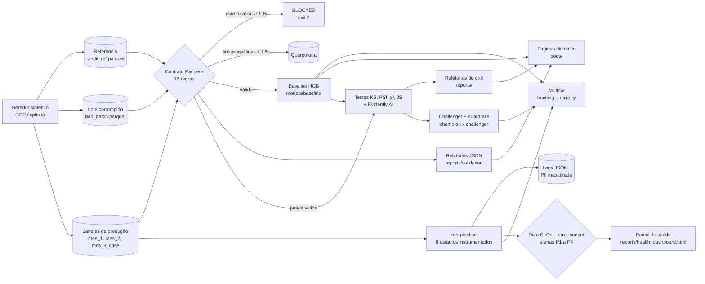
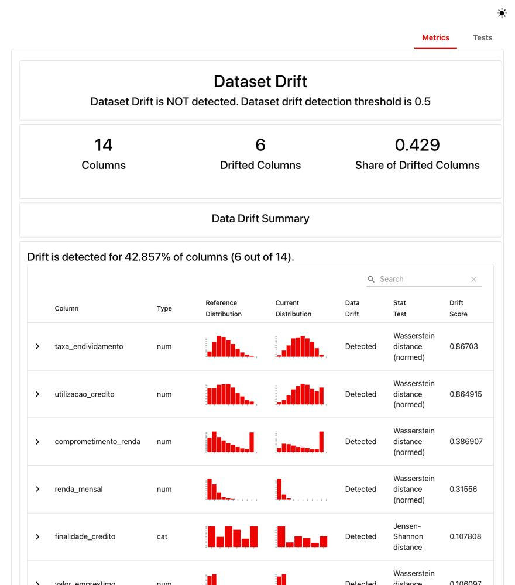
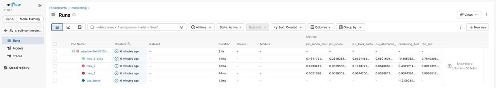
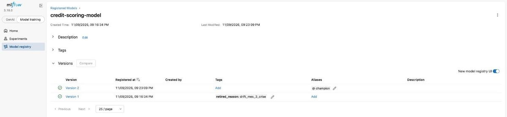
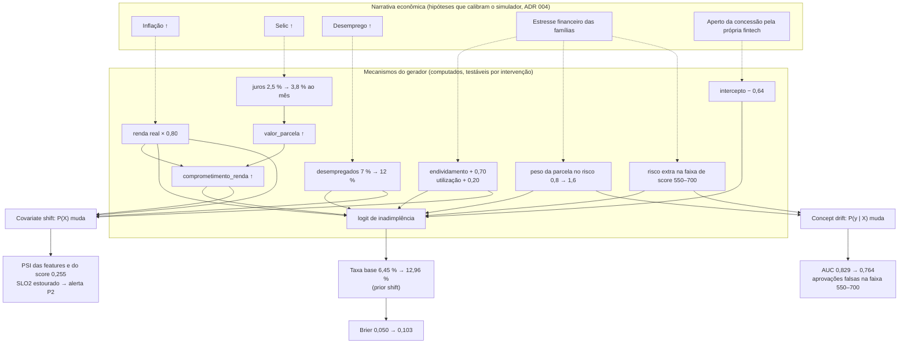

# Credit Sentinel — Tech Challenge Fase 4 (FIAP MLET)


> **Vídeo STAR (5 min):** *link publicado na release `v1.0.0-ga`.*
> **Páginas didáticas:** [índice das releases](docs/index.html) ·
> [Etapa 1 — contratos de dados](docs/releases/etapa-1-contratos.html) ·
> [Etapa 2 — drift](docs/releases/etapa-2-drift.html) ·
> [Etapa 3 — observabilidade](docs/releases/etapa-3-observabilidade.html)
> (também no GitHub Pages: <https://humbertosena.github.io/fiap-fase4-tech-challenge/>).

## 1. Resumo executivo

Uma fintech fictícia de crédito tem um modelo de *credit scoring* em produção. Com
inflação, juros altos e novos perfis de clientes, a diretoria suspeita de
**degradação silenciosa**: o modelo continua respondendo, mas decide pior. Este
repositório constrói a **camada de sustentação e confiabilidade** desse modelo:

1. **Barreira de qualidade na ingestão:** contrato de dados Pandera com 12 regras e
   *circuit breaker* que bloqueia lotes corrompidos (Etapa 1).
2. **Diagnóstico de degradação:** simulação de crise em três janelas mensais e
   detecção estatística de *drift* com KS, PSI e Evidently (Etapa 2).
3. **Observabilidade:** logs JSON, Data SLOs com *error budget*, alertas e MLflow
   (Etapa 3).
4. **Governança:** LGPD, auditoria de fairness e análise causal (Etapa 4).

Todos os dados são **sintéticos** (ADR 001); nenhum dado pessoal real é usado.

### Estado atual

| Etapa | Tema | Release | Status | Página |
| :--- | :--- | :--- | :--- | :--- |
| 1 | Validação de dados e contratos | `v0.1.0-alpha` | ✅ concluída | [etapa-1-contratos.html](docs/releases/etapa-1-contratos.html) |
| 2 | Simulação e detecção de drift | `v0.2.0-beta` | ✅ concluída | [etapa-2-drift.html](docs/releases/etapa-2-drift.html) |
| 3 | Observabilidade de pipelines e modelos | `v0.3.0-rc` | ✅ concluída | [etapa-3-observabilidade.html](docs/releases/etapa-3-observabilidade.html) |
| 4 | Governança (LGPD) e vídeo STAR | `v1.0.0-ga` | 🚧 em andamento | — |

## 2. Arquitetura



O pacote `credit_sentinel` (em `src/`) é organizado por capacidade, e cada subpacote
expõe seus subcomandos na CLI `credit-sentinel`:

| Subpacote | Responsabilidade | Release |
| :--- | :--- | :--- |
| `data` | Gerador sintético, lote corrompido, dicionário de dados | v0.1.0-alpha |
| `contracts` | Schema Pandera, circuit breaker, sanitizador de PII, export YAML | v0.1.0-alpha |
| `ml` | Features, treino, métricas, limiares, model card, MLflow, retreino do challenger e guardrails | v0.1.0-alpha e v0.3.0-rc |
| `drift` | Simulação das janelas, testes de drift, predições por janela, Evidently | v0.2.0-beta |
| `explainers` | Páginas HTML didáticas autocontidas | uma por release |
| `observability` | Logger JSON com PII mascarada, Data SLOs, alertas, pipeline e painel de saúde | v0.3.0-rc |
| `tracking` | Hook do MLflow por janela, Model Registry com aliases `champion` e `challenger` | v0.3.0-rc |
| `governance` | Auditoria de fairness por subgrupos (`fairness-audit`), também usada no G4 do retreino | v0.3.0-rc e v1.0.0-ga |

## 3. Guia de reprodução

Pré-requisitos: Python 3.12, [uv](https://docs.astral.sh/uv/) ≥ 0.12 e, opcionalmente,
Docker (MLflow em container).

```bash
git clone https://github.com/humbertosena/fiap-fase4-tech-challenge.git
cd fiap-fase4-tech-challenge
cp .env.example .env                 # troque CS_PII_SALT antes de qualquer uso real
make setup                           # uv sync --all-groups + validação do ambiente
make lint test                       # ruff estrito + pytest
make data                            # referência (12.000) + lote corrompido (600), bit a bit iguais
make validate                        # referência aprovada; lote corrompido BLOCKED (exit 2)
make train                           # valida, treina e registra o baseline no MLflow
make simulate                        # três janelas de produção (5.000 linhas cada)
make drift                           # testes de drift, scores e relatórios do Evidently
make pipeline                        # logs, Data SLOs, alertas, painel de saúde e runs no MLflow
make audit                           # fairness de champion e challenger (3 atributos, 4/5)
make causal                          # intervenções no simulador: efeito de cada choque no AUC
make explainers                      # gera docs/index.html e docs/releases/*.html
make mlflow                          # MLflow UI em http://localhost:5001
```

Tempos aproximados em um MacBook (Apple Silicon): `make setup` ≈ 1 min na primeira vez,
`make data` ≈ 2 s, `make train` ≈ 10 s, `make simulate` ≈ 3 s, `make drift` ≈ 6 s, `make pipeline` ≈ 7 s, suíte de testes ≈ 2 min.

Alternativa ao `make mlflow`: `docker compose up -d mlflow` sobe o mesmo servidor na
porta 5001 (a 5000 é usada pelo AirPlay no macOS), lendo o mesmo `mlruns/`.

| Comando da CLI | Efeito | Exit code |
| :--- | :--- | :--- |
| `credit-sentinel generate-data [--force]` | gera os datasets e `docs/data_dictionary.md` | 0, ou 1 se a referência já existir sem `--force` |
| `credit-sentinel validate --input <parquet> [--schema reference]` | valida um lote e grava `reports/validation/<lote>_report.json` | 0 aprovado · 2 bloqueado |
| `credit-sentinel train [--no-mlflow]` | treina o baseline e atualiza o model card | 0, ou 2 se a referência violar o contrato |
| `credit-sentinel simulate [--windows a,b] [--force]` | gera `data/production/<janela>.parquet` e imprime os deslocamentos | 0, ou 1 se a janela já existir sem `--force` |
| `credit-sentinel detect-drift [--window all\|<janela>]` | valida a janela, roda os testes de drift e o Evidently, grava `reports/` | 0 · 2 se o contrato bloquear a janela |
| `credit-sentinel run-pipeline [--window all\|<janela>] [--quick] [--strict] [--no-mlflow]` | executa os 6 estágios por janela, avalia os SLOs e grava `reports/slo_audit_report.json`, `reports/health_dashboard.html` e `logs/` | 0 · 2 com `--strict` se alguma janela for bloqueada |
| `credit-sentinel retrain-challenger [--promote] [--no-mlflow]` | retreina o challenger, avalia os 5 guardrails, registra a versão `@challenger` | 0 aprovado · 3 reprovado |
| `credit-sentinel promote-challenger` | promove o challenger registrado a `@champion` (exige guardrails aprovados) | 0 · 3 recusado · 1 sem relatório do challenger atual |
| `credit-sentinel fairness-audit [--strict]` | audita gênero, região e faixa etária de champion e challenger e grava `reports/fairness_audit.{json,md}` | 0 · 3 com `--strict` se algum grupo sair dos 4/5 |
| `credit-sentinel causal-ablation [--seeds N] [--rows N]` | regera a crise com um choque por vez e mede o AUC do champion; grava `reports/causal_ablation.{json,md}` | 0 · 1 sem baseline treinado |
| `credit-sentinel scan-pii <caminhos…>` | procura CPF, e-mail, telefone e ids em claro | 0 limpo · 1 achados |
| `credit-sentinel export-contract` | exporta `config/data_contract.yaml` | 0 |
| `credit-sentinel build-explainers [--etapa 1,2]` | gera as páginas didáticas | 0 |

## 4. Etapa 1 — Validação de dados e contratos

### 4.1 Dataset de referência

`data/reference/credit_ref.parquet`: 12.000 propostas (jul/2025 a jun/2026), 18
colunas, taxa base de inadimplência de 6,45 %, SHA-256
`cb41f7d3b239c3ea43e100f478ef8975c6c815abbcf1f89ad018b2f2a4224ec4`. O processo gerador
está no [ADR 001](docs/adr/001-dataset-sintetico.md) e as colunas no
[dicionário de dados](docs/data_dictionary.md). O
[notebook de EDA](notebooks/01_eda_and_data_quality.ipynb) traz o diagnóstico ICRA.

### 4.2 Contrato de dados (Pandera)

O contrato tem 12 regras, quatro vezes o mínimo de 3 pedido pelo enunciado. Está em
`src/credit_sentinel/contracts/schema.py` e é exportado para
[`config/data_contract.yaml`](config/data_contract.yaml) (ADR 002).

| Regra | Dimensão ICRA | Descrição | Severidade |
| :--- | :--- | :--- | :--- |
| R01 | Integridade | Schema estrito: colunas exatas (`strict=True`) e tipos exatos (`coerce=False`) | estrutural |
| R02 | Unicidade | `id_cliente` único, não nulo e no formato `CLI-` + 10 hexadecimais | estrutural |
| R03 | Completude | Renda, score, idade e endividamento sem nulos | linha |
| R04 | Acurácia | Idade entre 18 e 100 anos | linha |
| R05 | Acurácia | Renda mensal positiva e até R$ 1.000.000 | linha |
| R06 | Acurácia | Score de bureau entre 0 e 1000 | linha |
| R07 | Acurácia | Endividamento e utilização de crédito entre 0 e 1 | linha |
| R08 | Acurácia | Categorias nos domínios; prazo e alvo nos valores válidos | linha |
| R09 | Razoabilidade | Valores positivos; tempo de emprego e atrasos em faixas plausíveis | linha |
| R10 | Consistência | Parcela não excede a renda | linha |
| R11 | Consistência | Desempregado não tem tempo de emprego | linha |
| R12 | Consistência | Tempo de emprego compatível com a idade (a partir dos 16 anos) | linha |

**Circuit breaker em dois níveis:** violações estruturais bloqueiam o lote; violações
de linha vão para a quarentena (`data/quarantine/<run_id>.parquet`) enquanto forem até
1 % do lote; acima disso o breaker abre. Nunca há imputação silenciosa, e o inventário
é sempre completo (`lazy=True`).

### 4.3 Prova de bloqueio do lote corrompido

O lote `data/corrupted/bad_batch.parquet` (600 linhas) recebe dez anomalias
propositais, inclusive uma coluna `cpf` fictícia:

```console
$ uv run credit-sentinel validate --input data/corrupted/bad_batch.parquet
lote: bad_batch (600 linhas)
schema: credit_scoring_inference
decisão: BLOCKED — violação estrutural (R01, R02): lote bloqueado
regra  coluna                   falhas  check
R01    cpf                           1  column_in_schema
R01    score_bureau                 18  dtype('int64')
R02    id_cliente                   36  field_uniqueness
R02    id_cliente                    6  not_nullable
R03    renda_mensal                 24  not_nullable
R03    score_bureau                 18  not_nullable
R04    idade                        30  R04 · idade fora da faixa
R07    taxa_endividamento           12  R07 · taxa_endividamento fora da faixa
R08    situacao_emprego             18  R08 · situacao_emprego fora do domínio
R10    —                            12  R10 · valor_parcela <= renda_mensal
R11    —                             6  R11 · situacao_emprego == 'desempregado' => tempo_emprego_meses == 0
rejeitadas: 162 (27.00%) · válidas: 438
relatório: reports/validation/bad_batch_report.json
```

Relatórios completos em [`reports/validation/`](reports/validation/). As amostras de
falha trazem apenas `id_cliente_hash` (HMAC-SHA-256 com salt secreto), e
`credit-sentinel scan-pii reports docs` confirma que não há dado pessoal em claro.

### 4.4 Modelo baseline

`HistGradientBoostingClassifier` em `Pipeline` sklearn, com 14 features, sem
`genero`/`regiao` (ADR 003, [model card](docs/model_card.md)). O treino só acontece
depois que a referência passa pelo contrato.

| Métrica (validação, 2.400 propostas) | Valor | Critério |
| :--- | ---: | :--- |
| ROC-AUC | 0,829 | ≥ 0,80 |
| Brier | 0,052 | ≤ 0,06 |
| KS | 0,541 | ≥ 0,45 |
| F1 no limiar 0,125 | 0,383 | — |

Top-3 features por importância de permutação: `score_bureau`,
`qtd_parcelas_atraso_12m` e `utilizacao_credito`. O modelo é registrado no MLflow como
`credit-scoring-model` (experimento `credit-sentinel/baseline`) com assinatura de 14
colunas de entrada.

## 5. Etapa 2 — Simulação temporal e detecção de drift

### 5.1 A crise que simulamos

O mesmo gerador da referência produz três lotes mensais de 5.000 clientes, em
`data/production/` (separados fisicamente da referência). Cada janela sobrescreve só os
parâmetros que a narrativa econômica move: a inflação corrói a renda real, a Selic alta
encarece a parcela e as famílias se endividam. A justificativa de cada parâmetro e a
calibração estão no [ADR 004](docs/adr/004-cenarios-de-drift.md).

| Parâmetro | Referência | `mes_1` (jul/2026) | `mes_2` (ago/2026) | `mes_3_crise` (set/2026) | Tipo |
| :--- | ---: | ---: | ---: | ---: | :--- |
| Fator da renda real | 1,00 | 1,00 | 0,90 | 0,80 | covariate |
| Deslocamento do endividamento (logit) | 0 | 0 | +0,35 | +0,70 | covariate |
| Deslocamento da utilização de crédito | 0 | 0 | +0,06 | +0,20 | covariate |
| Juros mensais (Price) | 2,5 % | 2,5 % | 3,0 % | 3,8 % | covariate |
| Participação de desempregados | 7 % | 7 % | 9 % | 12 % | covariate |
| Finalidade: consolidação de dívidas | 20 % | 20 % | 26 % | 34 % | covariate |
| Peso da parcela no risco | 0,8 | 0,8 | 1,0 | 1,6 | concept |
| Concept drift na faixa de score 550 a 700 | 0 | 0 | 0 | 1,5 | concept |
| Ajuste residual do intercepto | 0 | 0 | 0 | −0,64 | prior |
| **Taxa de inadimplência resultante** | **6,45 %** | **6,06 %** | **8,60 %** | **12,96 %** | prior shift |

`mes_1` é o **controle**: nova amostra da mesma população, sem nenhuma mudança. Os valores
iniciais do spec levavam `mes_3_crise` a 21,6 % de inadimplência; a calibração (ADR 004,
seção 2.3) ajustou `gamma_concept`, a utilização e o intercepto residual, e manteve os
demais choques como previstos. Os arquivos são reproduzíveis bit a bit
(`make simulate`; hashes em [`registro.md`](docs/evidencias/etapa2/registro.md)).

### 5.2 Como o drift é detectado

Os testes nativos (`src/credit_sentinel/drift/statistical_tests.py`) tomam as decisões; o
Evidently AI dá a segunda opinião e o relatório visual. Cada janela é validada no
`inference_schema` antes da análise: um lote bloqueado encerra a execução com exit 2.

| Teste | Aplicação | Regra |
| :--- | :--- | :--- |
| Kolmogorov-Smirnov | features numéricas | drift se p < 0,05 e, com Bonferroni (÷ 12), p < 0,0042 |
| PSI (decis da referência) | features numéricas e score predito | menor que 0,10 estável · de 0,10 a 0,25 atenção · 0,25 ou mais crítico |
| Qui-quadrado | features categóricas | drift se p < 0,05 |
| Jensen-Shannon | features categóricas | magnitude de 0 a 1; alerta a partir de 0,10 |
| Wasserstein normalizado | features numéricas | informativo |
| Evidently `DataDriftPreset` | 14 features | drift por coluna (Wasserstein e Jensen-Shannon, corte de 0,1) |
| Evidently `ValueDrift` | alvo (teste z) e score | prior shift e drift da predição |

Com 5.000 linhas o KS enxerga deslocamentos minúsculos, então o relatório sempre lê o
p-valor junto com a magnitude (PSI): o drift de uma feature numérica é o KS corrigido; a
gravidade é o PSI. O score e o Evidently usam como referência o **holdout de validação**
(2.400 linhas), porque os scores das linhas de treino são otimistas.

### 5.3 Resultado: tabela de KS e PSI por feature e janela

Gerada por `detect-drift` em [`reports/drift_table.md`](reports/drift_table.md). **Negrito**
marca drift significativo (KS com Bonferroni ou qui-quadrado).

#### Features numéricas

| Feature | mes_1 p(KS) | mes_1 PSI | mes_2 p(KS) | mes_2 PSI | mes_3_crise p(KS) | mes_3_crise PSI |
| --- | ---: | ---: | ---: | ---: | ---: | ---: |
| `idade` | 0,7776 | 0,002 · estável | 0,1517 | 0,002 · estável | 0,9975 | 0,002 · estável |
| `renda_mensal` | 0,9595 | 0,002 · estável | **8,4e-18** | 0,029 · estável | **1,2e-79** | 0,161 · atenção |
| `score_bureau` | 0,8244 | 0,002 · estável | 0,3889 | 0,002 · estável | 0,9001 | 0,001 · estável |
| `taxa_endividamento` | 0,0489 | 0,004 · estável | **4,4e-103** | 0,171 · atenção | **3,8e-322** | 0,632 · crítico |
| `utilizacao_credito` | 0,3394 | 0,002 · estável | **9,2e-35** | 0,065 · estável | **4,4e-297** | 0,660 · crítico |
| `tempo_emprego_meses` | 0,8273 | 0,001 · estável | 0,1097 | 0,004 · estável | **1,2e-07** | 0,024 · estável |
| `qtd_parcelas_atraso_12m` | 1,0000 | 0,004 · estável | 1,0000 | 0,002 · estável | 1,0000 | 0,003 · estável |
| `valor_emprestimo` | 0,8619 | 0,002 · estável | 0,0312 | 0,006 · estável | **1,3e-10** | 0,027 · estável |
| `prazo_meses` | 1,0000 | 0,001 · estável | 0,8710 | 0,001 · estável | 1,0000 | 0,001 · estável |
| `valor_parcela` | 0,4096 | 0,003 · estável | **2,1e-05** | 0,014 · estável | **5,5e-15** | 0,033 · estável |
| `possui_imovel` | 1,0000 | 0,000 · estável | 1,0000 | 0,000 · estável | 0,9999 | 0,000 · estável |
| `comprometimento_renda` | 0,8786 | 0,003 · estável | **2,2e-15** | 0,031 · estável | **2,6e-77** | 0,145 · atenção |

PSI: menor que 0,10 estável; de 0,10 a 0,25 atenção; 0,25 ou mais crítico.

PSI: menor que 0,10 estável; de 0,10 a 0,25 atenção; 0,25 ou mais crítico.

#### Features categóricas

| Feature | mes_1 p(qui²) | mes_1 JS | mes_2 p(qui²) | mes_2 JS | mes_3_crise p(qui²) | mes_3_crise JS |
| --- | ---: | ---: | ---: | ---: | ---: | ---: |
| `situacao_emprego` | 0,9831 | 0,004 | **0,0098** | 0,026 | **7,3e-22** | 0,070 |
| `finalidade_credito` | 0,4162 | 0,016 | **7,3e-19** | 0,068 | **1,0e-88** | 0,142 |

#### Scores e performance do baseline

| Janela | P50 | P90 | P99 | Aprovação | PSI do score | AUC | Δ AUC vs validação | Δ AUC vs controle | Brier | Taxa base |
| --- | ---: | ---: | ---: | ---: | ---: | ---: | ---: | ---: | ---: | ---: |
| mes_1 | 0,030 | 0,145 | 0,433 | 87,6 % | 0,003 | 0,806 | -0,024 | — | 0,050 | 6,1 % |
| mes_2 | 0,034 | 0,201 | 0,514 | 82,4 % | 0,056 | 0,801 | -0,028 | -0,004 | 0,068 | 8,6 % |
| mes_3_crise | 0,047 | 0,282 | 0,590 | 74,7 % | 0,255 | 0,764 | -0,065 | -0,042 | 0,103 | 13,0 % |

### 5.4 Diagnóstico

- **Controle estável.** `mes_1` não tem nenhuma feature com PSI de 0,10 ou mais, nenhum
  drift após Bonferroni e 0 de 14 colunas em drift no Evidently. É a prova de que o
  detector não dá falso alarme.
- **Gradação.** `mes_2` fica na zona de atenção (`taxa_endividamento`, PSI 0,171) e
  `mes_3_crise` é crítico em duas features: `taxa_endividamento` (0,632) e
  `utilizacao_credito` (0,660). Também mudam `renda_mensal` e `comprometimento_renda`
  (atenção) e as duas categóricas (qui-quadrado significativo).
- **Prior shift.** A inadimplência vai de 6,45 % a 12,96 % e o Evidently reprova o teste do
  alvo em `mes_2` e `mes_3_crise`.
- **Concept drift.** Na faixa de score de 550 a 700, a inadimplência passa de 5,0 % na
  referência para 18,9 % no Mês 3 (3,8 vezes). O modelo, treinado antes, subestima esse risco.
- **Degradação do modelo.** O AUC cai de 0,829 (validação) para 0,764 no Mês 3, 0,065 a
  menos, e 0,042 abaixo do controle (0,806). O Brier dobra (0,050 → 0,103), a aprovação cai
  de 87,6 % para 74,7 % e o PSI do score vai a 0,255. P50, P90 e P99 do score sobem a cada
  janela: o modelo pontua clientes mais arriscados e acerta menos.
- **Nativo contra Evidently.** Concordam nas duas features críticas, no alvo e no score.
  Só os testes nativos apontam `tempo_emprego_meses`, `valor_parcela` e `situacao_emprego`
  (deslocamentos pequenos que KS e qui-quadrado detectam, abaixo do corte de 0,1 do
  Evidently). O Evidently informa "Dataset Drift is NOT detected" em `mes_3_crise` porque
  6 de 14 colunas (42,9 %) ficam abaixo do corte padrão de 50 % do dataset; o veredito por
  coluna é o que importa.
- **Ressalva.** `renda_mensal` em `mes_2` tem KS p = 8,4e-18, mas PSI de 0,029 (estável):
  o critério "PSI ≥ 0,10 na renda de `mes_2`" do spec não é atendido, e preferimos
  registrar isso a inflar o cenário (ADR 004 e registro da etapa).

### 5.5 Evidências

- [Relatório do Evidently AI](reports/evidently_drift_report.html) do Mês 3 (crise) e os
  de [`mes_1`](reports/evidently/mes_1_drift_report.html) e
  [`mes_2`](reports/evidently/mes_2_drift_report.html); sumário em
  [`evidently_drift_summary.json`](reports/evidently_drift_summary.json).
- [Página didática da Etapa 2](docs/releases/etapa-2-drift.html): linha do tempo das janelas,
  calculadora de PSI, mapa de calor, curva de concept drift e degradação do modelo.
- [Registro de verificação](docs/evidencias/etapa2/registro.md): hashes, critérios do spec e
  comparação entre os testes nativos e o Evidently.



## 6. Etapa 3 — Observabilidade, Data SLOs e MLflow

A Etapa 2 prova que o modelo degrada; esta etapa dá à operação o que ela precisa para
**agir**: logs que dizem o que aconteceu, SLOs que dizem se está bom ou ruim, alertas
que dizem o que fazer e um registro que diz qual modelo está em produção. As decisões
estão no [ADR 005](docs/adr/005-observabilidade-slos-mlflow.md).

### 6.1 Logs estruturados

`credit-sentinel run-pipeline` grava um evento JSON por linha em
`logs/pipeline_events.jsonl` (fora do git) e o espelha no stderr. Um filtro mascara
`CLI-xxxxxxxxxx`, CPF e e-mail **antes** de qualquer saída. Cada evento tem oito campos
obrigatórios, validados por `PipelineEvent`:

| Campo | Conteúdo |
| :--- | :--- |
| `timestamp` | instante UTC (respeita `SOURCE_DATE_EPOCH`) |
| `run_id` | uuid4 da execução do pipeline |
| `stage` | `ingestion`, `contract_validation`, `inference`, `drift_detection`, `slo_evaluation` ou `tracking` |
| `status` | `STARTED`, `SUCCESS`, `FAILED`, `BLOCKED` ou `SKIPPED` |
| `records_processed`, `rejected_records` | registros tratados e rejeitados pelo contrato |
| `latency_ms` | duração do estágio |
| `model_version` | versão do modelo avaliado |

Opcionais: `window`, `message` e `details`. O lote corrompido termina `BLOCKED` no estágio
`contract_validation`, e `inference` e `drift_detection` viram `SKIPPED`:

```json
{"timestamp": "2026-10-30T22:50:00.066509Z", "run_id": "6e4d013f-2bee-4b6b-bc62-3203a949a348", "stage": "contract_validation", "status": "BLOCKED", "records_processed": 600, "rejected_records": 162, "latency_ms": 39, "model_version": "baseline-1.0.0", "window": "bad_batch", "message": "violação estrutural (R01, R02): lote bloqueado", "details": {"regras": ["R01", "R02", "R03", "R04", "R07", "R08", "R10", "R11"], "rejected_ratio": 0.27}}
```

Uma amostra de 40 eventos já mascarados está em
[`pipeline_events_sample.jsonl`](docs/evidencias/etapa3/pipeline_events_sample.jsonl).

### 6.2 Data SLOs e error budget

Cinco SLIs por lote, declarados em [`config/slo_config.yaml`](config/slo_config.yaml):

| SLO | SLI | Meta |
| :--- | :--- | :--- |
| SLO1 · integridade | fração de linhas rejeitadas | ≤ 1 % |
| SLO2 · estabilidade | maior PSI nas 3 features mais importantes (`score_bureau`, `qtd_parcelas_atraso_12m`, `utilizacao_credito`) | ≤ 0,25 |
| SLO3 · consistência | fração das 5 numéricas principais com KS significativo (Bonferroni) | ≤ 0,34 |
| SLO4 · performance | ROC-AUC do lote (usa a verdade de campo) | ≥ 0,75 |
| SLO5 · latência | duração do lote | ≤ 60 s |

O SLO4 usa ROC-AUC em vez da acurácia do plano original: com 6 % de inadimplência, um
modelo que aprova todo mundo acerta 94 %. O **consumo do orçamento** é normalizado: `observado / limite`
nos objetivos `<=` e `(AUC de validação − observado) / (AUC de validação − limite)` no `>=`.
Abaixo de 70 % o SLO está `OK`, até 100 % em `WARN` e a partir de 100 % `BREACHED`. O
**saldo do lote** é `1 − média dos consumos`; negativo significa orçamento estourado.

### 6.3 Alertas e runbook

| Severidade | Gatilho | Ação |
| :--- | :--- | :--- |
| **P1** | o contrato bloqueou o lote | isolar o lote e acionar o produtor dos dados |
| **P2** | SLO2 ou SLO4 estourado | drift crítico: disparar o retreino do challenger |
| **P3** | algum SLO com 70 % ou mais do orçamento | monitorar a próxima janela |
| **P4** | nenhuma regra anterior | informativo |

Cada alerta aponta para uma seção do [runbook de incidentes](docs/runbook_incidentes.md),
com as fases Detecção, Triagem, Mitigação, Resolução e Pós-mortem para P1, P2 e P3.

### 6.4 Resultado nas quatro janelas

`credit-sentinel run-pipeline --window all` (7 s, com o Evidently) produz
[`slo_audit_report.json`](reports/slo_audit_report.json) e o
[painel de saúde](reports/health_dashboard.html), uma página autocontida com o estado
geral, os gauges de consumo por janela, o feed de alertas, a latência por estágio, o
mapa de PSI e os links do Evidently.

| Janela | Decisão | Alertas | Saldo do orçamento | O que aconteceu |
| :--- | :--- | :--- | ---: | :--- |
| `bad_batch` | `BLOCKED` | P1 | − 1.250 % | 27 % de linhas rejeitadas e violação estrutural (R01, R02): nada chega ao modelo |
| `mes_1` | `SUCCESS` | P4 | + 93 % | tudo dentro dos limites |
| `mes_2` | `SUCCESS` | P3 | + 40 % | SLO3 estourado (4 de 5 features com KS significativo), mas o PSI máximo é 0,065 |
| `mes_3_crise` | `SUCCESS` | P2 e 2 × P3 | − 17 % | SLO2 em 264 % (PSI 0,660), SLO3 em 235 % e SLO4 em 82 % (AUC 0,764) |

O contraste entre `mes_2` e `mes_3_crise` é o ponto didático: o KS acusa as duas janelas,
mas só o PSI das features que mais pesam no modelo separa o incômodo da crise.

### 6.5 MLflow: tracking e Model Registry

Cada execução vira um run pai (`pipeline-<run_id>`) no experimento
`credit-sentinel/monitoring`, com um run aninhado por janela: métricas de qualidade, de
drift (`psi_*`, `ks_p_*`), de performance, latência por estágio, consumo por SLO e saldo,
mais os relatórios (contrato, SLO, log e Evidently) como artefatos. Se o MLflow falhar, o
estágio `tracking` registra `FAILED` e o pipeline segue. O Model Registry guarda o
`credit-scoring-model`, com os aliases `champion` e `challenger`.

### 6.6 Champion × challenger

O challenger é treinado depois da detecção, com janela deslizante: últimos 6 meses da
referência, `mes_1`, `mes_2` e a **primeira quinzena** da crise (18.339 linhas). A segunda
quinzena de `mes_3_crise` (2.539 linhas) é o holdout temporal em que os dois modelos são
comparados. O motivo da quinzena de crise no treino está no ADR 005, seção 5: sem ela o
ganho medido ficou em +0,015 de AUC, abaixo dos +0,02 exigidos.

| Métrica no holdout | Champion (`baseline-1.0.0`) | Challenger (`challenger-1.0.0`) |
| :--- | ---: | ---: |
| ROC-AUC | 0,7605 | **0,7883** (+ 0,0279) |
| Brier | 0,0995 | **0,0957** |
| F1 | 0,3468 | **0,3973** |
| Taxa de aprovação | 74,5 % | 76,9 % |

Cinco guardrails decidem a promoção (`reports/gates_report.json`); todos aprovaram:

| Gate | Regra | Medido |
| :--- | :--- | :--- |
| G1 | AUC ≥ champion + 0,02 | 0,7883 contra 0,7805 exigido |
| G2 | Brier ≤ champion | 0,0957 contra 0,0995 |
| G3 | assinatura de entrada idêntica | 0 colunas divergentes |
| G4 | razão de impacto na aprovação em [0,80, 1,25] por gênero, região e faixa etária | pior: `regiao=Nordeste` com 0,934 |
| G5 | 5.000 linhas em até 5 s | 0,011 s |

`promote-challenger` moveu o alias `champion` para a versão 2 e marcou a versão 1 com
`retired_reason=drift_mes_3_crise`. `genero` e `regiao` seguem fora do modelo: só entram
na auditoria.

### 6.7 Evidências

- [Registro de verificação](docs/evidencias/etapa3/registro.md): comandos, saídas e critérios.
- [Página didática da Etapa 3](docs/releases/etapa-3-observabilidade.html): replay do pipeline, gauges de
  error budget, feed de alertas, champion × challenger e o mascaramento de PII ao vivo.
- Prints do MLflow UI em [`docs/evidencias/etapa3/`](docs/evidencias/etapa3/): lista de runs,
  métricas de drift de `mes_3_crise`, relatório do Evidently como artefato e o registry
  antes e depois da promoção.




## 7. Governança e LGPD (Privacy by Design & by Default)

A Etapa 4 responde às perguntas que a diretoria e o regulador fazem a um modelo de
crédito: que dados pessoais ele toca, com que base legal, por quanto tempo os guarda e se
trata grupos de forma desigual. As decisões estão no
[ADR 006](docs/adr/006-privacidade-e-governanca.md).

> **Sobre o escopo.** Os dados são sintéticos e não há titulares reais. As seções 7.3 e
> 7.4 descrevem a política que valeria em **produção**, e cada tabela diz o que o
> repositório já implementa e testa. As citações legais são da Lei 13.709/2018 (LGPD).
> As exigências do Banco Central entram só de forma genérica, sem número de resolução.

### 7.1 Inventário de dados e minimização

O tratamento segue o princípio da necessidade (art. 6º, III): cada coluna precisa de uma
finalidade, e o que não tem finalidade não entra. O contrato aceita 18 colunas
([dicionário de dados](docs/data_dictionary.md)); o modelo usa 13 delas mais a derivada
`comprometimento_renda`.

| Coluna | Finalidade | Categoria | Uso no modelo |
| :--- | :--- | :--- | :--- |
| `id_cliente` | unicidade (R02), junção com a verdade de campo e rastreabilidade | identificador (sintético, pseudonimizado na saída) | **não é feature**; vira `id_cliente_hash` |
| `data_referencia` | janela temporal de treino, validação e produção; contagem da retenção | temporal | não é feature |
| `idade` | capacidade de pagamento ao longo da vida | cadastral | feature; também auditada em faixas etárias |
| `renda_mensal` | capacidade de pagamento | financeiro | feature |
| `score_bureau` | histórico de crédito no mercado | financeiro | feature (a de maior importância) |
| `taxa_endividamento`, `utilizacao_credito` | endividamento existente e uso do rotativo | financeiro | features |
| `qtd_parcelas_atraso_12m` | comportamento de pagamento recente | financeiro | feature |
| `tempo_emprego_meses`, `situacao_emprego` | estabilidade da renda | cadastral e profissional | features |
| `valor_emprestimo`, `prazo_meses`, `valor_parcela` | características da operação pedida | operação | features |
| `finalidade_credito`, `possui_imovel` | finalidade declarada e garantia potencial | cadastral | features |
| `genero`, `regiao` | **exclusivamente** a auditoria de fairness | atributo protegido para auditoria | **fora do modelo** |
| `inadimplente` | alvo: atraso acima de 90 dias | resultado observado | rótulo de treino e de avaliação |

Duas observações sobre as categorias:

- "Atributo protegido para auditoria" é uma categoria **do projeto**. Gênero e região não
  estão na lista de dado pessoal sensível do art. 5º, II, da LGPD (origem racial ou étnica,
  saúde, biometria e afins), mas são os eixos em que uma decisão de crédito não pode
  discriminar. Tratá-los à parte, fora do modelo, é uma escolha de cautela.
- `idade` é feature legítima de risco e também é auditada, em quatro faixas (18–29, 30–44,
  45–59 e 60+).

**O que fica de fora de propósito:** CPF, nome, endereço, telefone e e-mail. Nenhum deles
melhora o score, e cada um aumenta o dano de um vazamento. A prova é técnica: a regra R01
(schema estrito) rejeita qualquer coluna fora do contrato como violação **estrutural**, e
o lote corrompido do projeto, que traz uma coluna `cpf`, termina bloqueado. Trecho de
[`bad_batch_report.json`](reports/validation/bad_batch_report.json):

```json
{"rule_id": "R01", "column": "cpf", "check": "column_in_schema", "n_failures": 1}
```

O relatório inteiro registra `"decision": "BLOCKED"` (`blocked_reason`: "violação
estrutural (R01, R02): lote bloqueado"), e o `credit-sentinel validate` sai com código 2.
A deny-list do sanitizador (`cpf`, `nome`, `email`, `telefone`, `endereco`, `rg`) é a
segunda barreira para dados que cheguem por outro caminho.

### 7.2 PII e tecnologias de proteção (PETs)

A proteção não depende de um único mecanismo. São cinco camadas, da entrada à saída, e
cada uma tem um teste ou um passo da CI que a verifica:

| Camada | Técnica | Onde | Verificação |
| :--- | :--- | :--- | :--- |
| 1. Entrada | contrato estrito: coluna fora da lista (como `cpf`) bloqueia o lote | `contracts/schema.py`, regra R01 | lote `bad_batch` termina `BLOCKED` (seção 7.1) |
| 2. Identificador | pseudonimização HMAC-SHA-256 com salt | `contracts/privacy_sanitizer.py`, `drift/predictions.py` | `tests/unit/test_privacy_sanitizer.py` |
| 3. Colunas proibidas | deny-list de identificadores diretos | `drop_direct_identifiers` | `tests/unit/test_privacy_sanitizer.py` |
| 4. Logs | mascaramento antes de qualquer saída | `observability/logger.py` | `tests/unit/test_logger.py` |
| 5. Saídas | varredura `scan-pii` em relatórios, documentação e logs | CLI e CI (job `smoke`) | exit 1 se achar algo |

#### Pseudonimização e o salt

`id_cliente_hash = HMAC-SHA-256(salt, id_cliente)`. O resultado é determinístico: o mesmo
cliente gera o mesmo hash em todos os lotes, o que permite juntar predições à verdade de
campo e localizar um titular sem expor o id. Um hash simples, sem chave, não protegeria:
os ids têm a forma `CLI-` mais 10 dígitos hexadecimais (cerca de 1,1 × 10¹² valores), e
um atacante enumera esse espaço. Com o salt como **chave** do HMAC, quem tem só o hash
não volta ao id.

- **Onde o salt vive.** Na variável `CS_PII_SALT`, lida do arquivo `.env`, que não é
  versionado. `.env.example` traz apenas um marcador. Em `Settings` o campo é um
  `SecretStr`, então o valor não aparece quando o objeto é impresso (`repr`). Em produção
  o valor vem de um cofre de segredos, com leitura restrita ao processo do pipeline.
- **Rotação (política).** Anual, e imediata em caso de suspeita de vazamento. O novo salt
  vale para os hashes novos; o anterior fica sob custódia do encarregado até o fim do
  prazo de retenção dos dados que ele protege, para que uma busca por titular teste cada
  versão do salt ainda vigente.
- **Limitação conhecida.** Se `CS_PII_SALT` não estiver definida, o código usa um salt de
  desenvolvimento (`dev-salt-nao-usar-em-producao`), e as predições versionadas neste
  repositório foram geradas com ele. É aceitável porque os ids são sintéticos. Em
  produção a ausência do salt deveria **abortar** a execução; isso não está implementado
  e consta nos trabalhos futuros.

#### Mascaramento em logs

O logger passa cada evento por `mask_record` e `redact_text`, que trocam por `***` o id
de cliente, o CPF (com ou sem pontuação), o e-mail e o telefone brasileiro. Um texto como
"falha no cliente \<id\>, contato \<e-mail\>, CPF \<cpf\>" é gravado como
`falha no cliente ***, contato ***, CPF ***`, e um registro com as chaves `id_cliente` e
`cpf` tem os dois valores trocados por `***`, enquanto métricas como `latencia_ms` passam
intactas. A mesma regra roda em JavaScript na
[página da Etapa 3](docs/releases/etapa-3-observabilidade.html), onde dá para testar o
mascaramento ao vivo.

#### Deny-list e `scan-pii`

A deny-list (`cpf`, `nome`, `email`, `telefone`, `endereco`, `rg`) remove essas colunas de
qualquer tabela que chegue ao sanitizador. O `credit-sentinel scan-pii <caminhos>` varre
arquivos `.json`, `.jsonl`, `.html`, `.md`, `.csv`, `.txt` e `.log` em busca de CPF,
e-mail, telefone e `id_cliente` em claro. Ignora blobs `data:…;base64` e e-mails de
domínios reservados a exemplos (`.exemplo`, `example.com`, `example.org`). A CI roda
`scan-pii reports docs logs` no job `smoke`, e um achado derruba o pipeline:

```bash
$ uv run credit-sentinel scan-pii README.md docs reports logs
nenhum dado pessoal encontrado em: README.md, docs, reports, logs
```

#### Segregação dos atributos protegidos

`genero` e `regiao` são coletados para a auditoria de fairness e **nunca** viram feature:
`dd.SENSITIVE_COLUMNS` fica fora de `FEATURE_COLUMNS`, e `tests/unit/test_features.py` e
`tests/unit/test_dictionary.py` falham se uma dessas colunas entrar na lista de entradas
do modelo. A assinatura de entrada do champion e a do challenger é a mesma (gate G3).
A auditoria só publica **agregados** por grupo; o menor grupo auditado tem 194 clientes.

#### Atendendo o pedido de um titular (art. 18, I e II)

O pedido chega com o id; o pipeline calcula o hash e procura nas saídas. O exemplo usa um
marcador no lugar do id real:

```python
import pandas as pd
from credit_sentinel.contracts.privacy_sanitizer import hash_identifier
from credit_sentinel.settings import get_settings

salt = get_settings().pii_salt.get_secret_value()
chave = hash_identifier("CLI-XXXXXXXXXX", salt)       # id informado pelo titular
scores = pd.read_parquet("reports/predictions/mes_3_crise_scores.parquet")
print(scores[scores.id_cliente_hash == chave])
```

Para o primeiro cliente de `mes_3_crise` a busca devolve uma linha: hash `77ca0ab3…`,
score 0,0151 e `pred = 0` (aprovado, porque o score está abaixo do limiar de 0,1248).
Nenhum id em claro é necessário para responder: o resultado traz a decisão e o score, e
os critérios gerais saem da seção 7.3.

### 7.3 Base legal e decisões automatizadas

| Tratamento | Hipótese | Dispositivo |
| :--- | :--- | :--- |
| Análise de risco e decisão de crédito, monitoramento de drift e auditoria | **proteção ao crédito** (base principal) | art. 7º, X |
| Coleta dos dados da proposta, a pedido do titular | execução de contrato ou procedimentos preliminares | art. 7º, V |
| Prevenção à fraude | legítimo interesse, com teste de balanceamento | art. 7º, IX e art. 10 |

A proteção ao crédito é a base principal porque o tratamento existe para avaliar e
proteger o crédito concedido. A execução de contrato cobre a coleta feita para analisar o
pedido que o próprio titular fez. O legítimo interesse fica restrito à prevenção à fraude,
em que o balanceamento é defensável; como base geral do scoring ele deixaria cada decisão
exposta a contestação.

**Teste de balanceamento (prevenção à fraude), resumido:**

| Passo | Resposta |
| :--- | :--- |
| Finalidade legítima, em situação concreta | evitar fraude na concessão, que protege a instituição e os clientes honestos |
| Necessidade | só os atributos da proposta e o `id_cliente_hash`, já tratados; nenhum dado novo é coletado para essa finalidade (art. 10, § 1º) |
| Expectativa do titular e impacto | quem pede crédito espera verificações antifraude; o impacto é uma análise adicional, sem negativa automática |
| Salvaguardas | pseudonimização, mascaramento em logs, transparência sobre o tratamento (art. 10, § 2º) e direito de oposição (art. 18, § 2º) |

#### Direitos do titular (art. 18) e como o pipeline os atende

| Direito | Como o pipeline atende | Situação |
| :--- | :--- | :--- |
| Confirmação e acesso (I e II) | localizar o titular por `id_cliente_hash` nas predições e nos relatórios e devolver score, decisão e critérios gerais | hash implementado; fluxo de atendimento é política |
| Correção (III) | novo lote corrigido na origem, revalidado pelo contrato (12 regras); a nova predição passa a valer | contrato implementado; reprocessamento é política |
| Anonimização, bloqueio ou eliminação do que é desnecessário (IV) | a R01 impede a entrada de colunas excedentes; a eliminação por hash segue o plano da seção 7.4 | R01 implementada; eliminação é política |
| Portabilidade (V) | exportar o registro do titular em formato estruturado (parquet, CSV ou JSON) | política |
| Oposição ao tratamento por legítimo interesse (§ 2º) | a prevenção à fraude é a única finalidade nessa base e pode ser suspensa para o titular | política |

#### Revisão de decisão automatizada e explicabilidade (art. 20)

O art. 20 dá ao titular o direito de **solicitar a revisão** de decisões tomadas
unicamente por tratamento automatizado que afetem seus interesses, incluídas as que
definem o seu perfil de crédito, e o de receber informações claras sobre os critérios e
os procedimentos usados (respeitados os segredos comercial e industrial).

- **Critérios.** A decisão é `score ≥ limiar → negar`. O limiar operacional do champion é
  0,1248 (o do F1 na validação); o limiar de custo, em que aprovar um inadimplente custa 5
  vezes mais do que negar um bom pagador, dá 0,124, praticamente o mesmo. A importância por permutação (queda de ROC-AUC ao embaralhar a
  feature, em [`feature_importance.json`](models/baseline/feature_importance.json)) mostra
  o que mais pesa:

  | Feature | Importância (champion) |
  | :--- | ---: |
  | `score_bureau` | 0,161 |
  | `qtd_parcelas_atraso_12m` | 0,012 |
  | `utilizacao_credito` | 0,011 |
  | `renda_mensal` | 0,010 |
  | `taxa_endividamento` | 0,010 |

- **Revisão.** O repositório não implementa o fluxo de revisão. A política proposta é
  que todo pedido de revisão seja analisado por uma **pessoa**, com acesso ao score, à
  decisão e aos critérios acima. O art. 20, na redação em vigor, não exige que o revisor
  seja humano: essa é uma escolha de governança do projeto.
- **Razões de recusa individuais** (os fatores que mais pesaram em cada negativa) ficam
  como evolução: a importância por permutação é global e não explica uma decisão isolada.

### 7.4 Ciclo de vida dos dados e retenção

Prazos, acessos e descarte **de produção** (alvo). O prazo de 5 anos para registros de
operações de crédito se apoia na guarda exigida pelo regulador do setor e no art. 16, I,
da LGPD (conservação para cumprir obrigação legal ou regulatória); precisa ser
confirmado com o jurídico antes de entrar em operação.

| Tipo de dado | Onde está no repositório | Dado pessoal? | Prazo-alvo | Descarte |
| :--- | :--- | :--- | :--- | :--- |
| Propostas pseudonimizadas | `data/reference`, `data/production` | sim, pseudonimizado | 5 anos após o encerramento da operação | eliminação segura, ou anonimização irreversível se mantidas para estatística (art. 16, II e IV) |
| Linhas em quarentena | `data/quarantine` (fora do git) | sim | 30 dias, o tempo de corrigir na origem | eliminação |
| Features e conjuntos de treino | derivados dos anteriores | sim, pseudonimizado | enquanto o modelo estiver vigente, mais 5 anos | eliminação junto com o modelo |
| Scores e decisões | `reports/predictions` | sim, só `id_cliente_hash` | 5 anos (rastreabilidade da decisão, art. 20) | eliminação |
| Logs do pipeline | `logs/` (fora do git) | não, mascarados | 90 dias | rotação automática |
| Relatórios de drift, SLO e fairness | `reports/` | não, agregados | vida do modelo, mais 5 anos | arquivamento |
| Modelos e metadados | `models/`, `mlruns/` | não | vigência, mais 5 anos após a aposentadoria | arquivamento |
| Salt do HMAC | `.env` (cofre em produção) | segredo | enquanto existir dado associado | destruição após o último descarte |

**Controle de acesso (RBAC), em produção.** Papéis e o que cada um enxerga:

| Papel | Propostas pseudonimizadas | Quarentena | Scores e decisões | Logs e relatórios | Salt |
| :--- | :---: | :---: | :---: | :---: | :---: |
| Engenharia de dados | escreve | escreve | — | lê | — |
| Ciência de dados | lê | — | lê | lê | — |
| MLOps e SRE | — | — | — | lê e escreve | guarda no cofre |
| Auditoria e compliance | — | — | lê | lê | — |
| Encarregado (DPO) | lê, para atender titulares | lê | lê | lê | autoriza o uso |
| Analista de revisão (art. 20) | só o caso revisado | — | só o caso revisado | — | — |

**O que este repositório faz, e o que não faz:**

- Faz: dados 100 % sintéticos; salt, logs, `mlruns/` e quarentena fora do git; pseudonimização
  e mascaramento por código; `scan-pii` na CI (seção 7.2).
- Não faz: expurgo automático por prazo, controle de acesso por papel e cofre de segredos.
  Um repositório de arquivos não tem usuários nem titulares, então esses controles são
  projeto de produção, descritos aqui e não executados.
- O ADR 006 registra a mesma fronteira, para que ninguém leia a tabela acima como
  funcionalidade pronta.

### 7.5 Mitigação de viés

#### Metodologia

`credit-sentinel fairness-audit` (ou `make audit`) mede **12 combinações**: 3 atributos
(`genero`, `regiao` e `faixa_etaria`, derivada de `idade`) × 2 modelos (champion e
challenger) × 2 conjuntos de dados. O resultado vai para
[`fairness_audit.json`](reports/fairness_audit.json) e para
[`fairness_audit.md`](reports/fairness_audit.md), com o detalhe por grupo.

| Medida | Definição |
| :--- | :--- |
| Aprovação | fração com `score < limiar` (o modelo nega quando `score ≥ limiar`) |
| Razão de impacto | aprovação do grupo ÷ aprovação do maior grupo do atributo; aceitável em [0,80, 1,25] (regra dos 4/5) |
| TPR | fração dos inadimplentes que o modelo nega |
| FPR | fração dos bons pagadores que o modelo nega |
| Diferença de oportunidade | TPR do grupo − TPR do grupo de referência |

| Conjunto de dados | n | O que é |
| :--- | ---: | :--- |
| `referencia_validacao` | 2.400 | os 20 % de validação do baseline; o challenger treinou com os últimos seis meses da referência e **viu parte** destes clientes |
| `mes_3_crise_holdout` | 2.539 | dias 16 a 30 da crise; nenhum dos modelos treinou com eles |

Por isso a leitura que decide é a da crise: é o único conjunto em que os dois modelos
são comparados sem vantagem de treino. A regra dos 4/5 é uma heurística de triagem, de
origem na seleção de pessoal nos Estados Unidos, e não um limite legal brasileiro; ela
é lida junto com TPR, FPR e a taxa de inadimplência observada de cada grupo. O
art. 6º, IX, da LGPD veda o tratamento para fins discriminatórios ilícitos ou abusivos, e
o art. 20, § 2º, prevê que a autoridade nacional audite aspectos discriminatórios em
decisões automatizadas. Daí o relatório ser versionado.

#### Resultado: todos os grupos dentro de 4/5

Pior razão de impacto por atributo (o grupo mais distante de 1,0):

| Atributo | Validação · champion | Validação · challenger | Crise · champion | Crise · challenger |
| :--- | :--- | :--- | :--- | :--- |
| `genero` | `M` · 1,010 | `M` · 0,993 | `M` · 1,001 | `M` · 1,015 |
| `regiao` | `Centro-Oeste` · 0,959 | `Sul` · 1,027 | **`Nordeste` · 0,894** | `Nordeste` · 0,934 |
| `faixa_etaria` | `60+` · 0,949 | `60+` · 0,979 | `60+` · 0,980 | `18-29` · 0,953 |

Gênero e faixa etária são praticamente neutros. O ponto de atenção é a **região na
crise**, onde o champion chega a 0,894, perto do piso de 0,80. A tabela abaixo abre esse
caso:

| Região | n | Inadimpl. observada | Champion: aprovação · razão · FPR | Challenger: aprovação · razão · FPR |
| :--- | ---: | ---: | :--- | :--- |
| Sudeste (referência) | 1.039 | 13,5 % | 77,3 % · 1,000 · 18,5 % | 77,9 % · 1,000 · 17,0 % |
| Sul | 365 | 9,6 % | 80,0 % · 1,035 · 18,5 % | 81,9 % · 1,052 · 14,8 % |
| Centro-Oeste | 220 | 11,4 % | 72,7 % · 0,941 · 24,1 % | 76,4 % · 0,981 · 19,5 % |
| Norte | 223 | 11,7 % | 70,9 % · 0,917 · 24,4 % | 78,0 % · 1,002 · 17,3 % |
| Nordeste | 692 | 12,9 % | 69,1 % · 0,894 · 26,4 % | 72,7 % · 0,934 · 22,1 % |

**O que a tabela mostra**

1. **Aprovação menor sem risco maior.** O Nordeste tem inadimplência observada de 12,9 %,
   abaixo da do Sudeste (13,5 %), e mesmo assim o champion aprova 69,1 % contra 77,3 % e
   nega 26,4 % dos bons pagadores contra 18,5 %: 1,43 vez a taxa do Sudeste.
2. **A renda é um intermediário, não a explicação inteira.** `regiao` está fora do modelo,
   mas a renda varia com ela (o gerador aplica fatores de renda por região, ADR 001). Na
   segunda quinzena da crise, a renda mediana é R$ 2.198 no Nordeste e R$ 3.196 no
   Sudeste, e 46,8 % dos bons pagadores nordestinos estão no terço de menor renda, contra
   25,4 % no Sudeste. Aplicando a taxa de negação de cada faixa de renda à composição de
   cada região, o FPR esperado só pela renda é 24,1 % no Nordeste e 20,0 % no Sudeste:
   explica cerca de **4,1 dos 7,9 pontos percentuais** da diferença observada. O restante
   não é explicado por esta análise.
3. **O challenger reduz a diferença.** A razão do Nordeste sobe de 0,894 para 0,934, a do
   Norte de 0,917 para 1,002, e o FPR cai nos 11 grupos auditados (por exemplo, Norte de
   24,4 % para 17,3 %). O Sul passa a 1,052, acima da referência, ainda dentro da faixa.
4. **Cuidado com grupos pequenos.** A diferença de oportunidade do champion vai de +0,154
   (Norte) a −0,157 (Sul), mas o Norte tem cerca de 26 inadimplentes: o intervalo de
   confiança de 95 % do seu TPR é de aproximadamente ±18 pontos percentuais. Com tão poucos
   casos, essas diferenças não são conclusivas sozinhas.

<details>
<summary>Como reproduzir a análise de renda do item 2</summary>

```python
import pandas as pd
from pathlib import Path
from credit_sentinel.drift.predictions import decision_threshold
from credit_sentinel.ml.train_baseline import load_model_bundle, predict_proba

modelo = load_model_bundle(Path("models/baseline"))
d = pd.read_parquet("data/production/mes_3_crise.parquet")
d = d[d.data_referencia >= "2026-09-16"].copy()          # holdout: dias 16 a 30
d["negado"] = (predict_proba(modelo, d) >= decision_threshold(modelo)).astype(int)
bons = d[d.inadimplente == 0].copy()
bons["faixa_renda"] = pd.qcut(bons.renda_mensal, 3, labels=False)
bons["fpr_esperado"] = bons.faixa_renda.map(bons.groupby("faixa_renda").negado.mean())
print(bons.groupby("regiao")[["negado", "fpr_esperado"]].mean().round(3))
```

</details>

#### Ações quando um grupo sai dos 4/5

Nenhum grupo saiu da faixa, então nenhuma correção foi aplicada ao modelo. A política,
caso ocorra, vai do menos ao mais invasivo:

| Passo | Ação | Observação |
| :--- | :--- | :--- |
| 1 | confirmar o achado: tamanho do grupo, intervalo de confiança e repetição em outra janela | evita corrigir ruído |
| 2 | procurar o intermediário (como a renda acima) e avaliar a feature | retirar ou transformar só se não for essencial ao risco |
| 3 | reponderar as amostras do treino por grupo e rótulo | validar de novo nos gates G1 e G2 |
| 4 | revisão humana da faixa de score próxima ao limiar | política de revisão do art. 20 (seção 7.3) |
| 5 | limiar por grupo | último recurso: tratar de forma diferente por atributo protegido pode ser, em si, discriminatório; exige parecer jurídico e registro |

O gate **G4** já impede promover um challenger fora dos 4/5, e
`credit-sentinel fairness-audit --strict` sai com código 3 nesse caso, o que permite
usá-lo como trava na CI. A vigilância recomendada hoje é o **Nordeste** (razão 0,934 no
modelo em produção, o challenger promovido): repetir `make audit` a cada retreino e a cada
janela nova.

## 8. Análise de inferência causal da degradação

O PSI e o KS dizem **o que** mudou; para decidir o que fazer é preciso saber **por que o
modelo piorou** e **qual alavanca o conserta**. Como o projeto é dono do gerador de dados
(ADR 001 e ADR 004), dá para ir além da correlação: além do grafo causal e das evidências
por janela, a seção 8.3 faz **intervenções**, revertendo um choque por vez na janela de
crise e medindo o efeito no modelo.

### 8.1 O grafo causal



Linhas tracejadas são a **narrativa** (hipóteses de calibração: ninguém mede a inflação
dentro do simulador). Linhas contínuas são **mecanismos do gerador**: valores de entrada
que o código transforma em colunas e em risco, e que por isso podem ser revertidos um a
um. Os três tipos de drift aparecem em nós distintos porque têm efeitos distintos no
modelo, como a seção 8.3 mostra.

### 8.2 Evidência por janela

Choques de entrada e efeitos observados (números das seções 5.3 e 5.4):

| Janela | Renda real · juros · desemprego | PSI renda | PSI endivid. | PSI utiliz. | PSI comprom. | **PSI `score_bureau`** | Taxa base | Aprovação | AUC |
| :--- | :--- | ---: | ---: | ---: | ---: | ---: | ---: | ---: | ---: |
| `mes_1` (controle) | 1,00 · 2,5 % · 7 % | 0,002 | 0,004 | 0,002 | 0,003 | 0,002 | 6,1 % | 87,6 % | 0,806 |
| `mes_2` | 0,90 · 3,0 % · 9 % | 0,029 | 0,171 | 0,065 | 0,031 | 0,002 | 8,6 % | 82,4 % | 0,801 |
| `mes_3_crise` | 0,80 · 3,8 % · 12 % | 0,161 | 0,632 | 0,660 | 0,145 | **0,001** | 13,0 % | 74,7 % | 0,764 |

A coluna em destaque é a mais importante da tabela: a feature que mais pesa no modelo,
`score_bureau`, **não se move** (PSI 0,001), e é justamente na faixa de 550 a 700 dela
que a inadimplência passa de 5,0 % para 18,9 % (seção 5.4). O detector de drift por
feature não enxerga esse problema.

Evidência por aresta:

| Aresta | Evidência | Leitura |
| :--- | :--- | :--- |
| inflação → renda real ↓ | `renda_mensal`: KS p = 1,2e-79 e PSI 0,161 em `mes_3_crise` | confirmada; o PSI é só "atenção" |
| estresse das famílias → endividamento e utilização ↑ | PSI de 0,632 e 0,660 em `mes_3_crise` (0,171 e 0,065 em `mes_2`) | as duas features críticas; sobem de forma gradual |
| Selic → parcela → comprometimento ↑ | `comprometimento_renda`: PSI 0,031 → 0,145 | confirmada nas features; o efeito sobre o AUC é pequeno (8.3) |
| estresse → risco extra na faixa 550–700 | inadimplência da faixa: 5,0 % → 18,9 % | confirmada; é o que derruba o AUC (8.3) |
| desemprego → taxa base ↑ | só o desemprego eleva a taxa base de 5,99 % para 6,48 % (média de 10 sementes, seção 8.3) | existe, mas é pequeno |
| aperto da concessão → taxa base ↓ | sem o ajuste de − 0,64 a taxa média seria 18,9 %, e não 12,2 % (seção 8.3) | mitigador forte, ver 8.5 |

### 8.3 Intervenções: o que derruba o AUC?

Cada linha gera a janela de crise (5.000 clientes) só com os choques indicados; o restante fica nos
valores da referência. As **mesmas 10 sementes** (45 a 54; a 45 é a da janela `mes_3_crise` versionada) valem
para todos os cenários, então os sorteios aleatórios são comuns e a comparação isola o efeito do choque. O
modelo medido é o de produção (`baseline-1.0.0`), sem retreino, e a tabela traz a média e o desvio-padrão
da queda de AUC em relação ao controle da mesma semente. Os números vêm de
[`reports/causal_ablation.json`](reports/causal_ablation.json) (parâmetros de cada cenário em
[`causal_ablation.md`](reports/causal_ablation.md)).

| Cenário | Taxa base | AUC do baseline | Δ AUC vs. controle |
| :--- | ---: | ---: | :--- |
| **Controle** (sem nenhum choque) | 5,99 % | 0,795 | — |
| **Crise completa** | 12,22 % | 0,757 | − 0,038 ± 0,012 |
| Só **covariate shift** (6 choques) | 10,69 % | 0,785 | − 0,010 ± 0,012 |
|  · só renda + endividamento + utilização | 9,80 % | 0,781 | − 0,014 ± 0,012 |
| Só **concept drift** (peso da parcela + faixa 550–700) | 10,75 % | 0,759 | **− 0,036 ± 0,011** |
|  · só a faixa 550–700 | 10,32 % | 0,752 | **− 0,043 ± 0,011** |
|  · só juros + peso da parcela | 6,49 % | 0,800 | + 0,005 ± 0,005 |
| Só **desemprego** | 6,48 % | 0,799 | + 0,003 ± 0,006 |
| Crise **sem** concept drift | 6,49 % | 0,793 | − 0,002 ± 0,007 |
| Crise **sem** o risco extra da faixa 550–700 | 7,21 % | 0,797 | + 0,001 ± 0,005 |
| Crise **sem** o aperto da concessão | 18,89 % | 0,756 | − 0,039 ± 0,015 |

**O que isso diz**

1. **O concept drift explica quase toda a queda de AUC.** Sozinho, ele reproduz a perda da
   crise (− 0,036 contra − 0,038), e retirá-lo da crise devolve o AUC ao nível do controle.
2. **O covariate shift mexe nas taxas, não no ranking.** Eleva a taxa base de 6 % para
   10,7 % e derruba a aprovação, mas a queda de AUC (− 0,010 ± 0,012) não se distingue de
   zero. O modelo aprendeu a relação entre as features e o risco, e essa relação continua
   valendo quando o cliente típico muda de lugar.
3. **O encarecimento do crédito (juros e peso da parcela) quase não afeta o AUC**
   (+ 0,005 ± 0,005), porque `comprometimento_renda` é feature do modelo. Ele desloca a
   calibração, não a ordenação. A hipótese de que a Selic, sozinha, causa o concept drift
   **não** se sustenta nestes dados: o que machuca é o risco extra da faixa intermediária.
4. **A fonte do alerta não é a fonte do dano.** O P2 da crise veio do SLO2 (PSI de
   `utilizacao_credito`, 0,660), um sintoma de covariate shift; o SLO4 (AUC) consumiu 82 %
   do orçamento e não estourou (seção 6.4). O alerta chegou pelo covariate shift, e o dano
   veio do concept drift. Em produção essa ordem é natural: o PSI sai na hora, e o AUC só
   depois que os rótulos amadurecem (inadimplência é atraso acima de 90 dias).

Para reproduzir: `make causal` (`credit-sentinel causal-ablation`, cerca de 5 s). O catálogo de cenários e
o cálculo estão em `src/credit_sentinel/governance/causal_ablation.py`; `tests/unit/test_causal_ablation.py`
garante que um cenário "só" liga apenas os choques listados e que um "sem" desliga apenas eles.

### 8.4 Por que o modelo estático erra: a faixa intermediária

O baseline foi treinado quando a faixa de 550 a 700 de `score_bureau` tinha risco
moderado. Na crise, esses clientes passam a inadimplir muito mais, sem que nenhuma feature
se mova. O modelo continua dando a eles o score de antes e **aprova**. No holdout da crise
(dias 16 a 30):

| Faixa 550–700 de `score_bureau` | Champion (`baseline-1.0.0`) | Challenger (`challenger-1.0.0`) |
| :--- | ---: | ---: |
| Clientes na faixa | 1.062 (42 % do holdout) | 1.062 |
| Inadimplência observada | 18,3 % (fora da faixa: 8,2 %) | 18,3 % |
| Risco médio previsto pelo modelo | 8,7 % | 12,0 % |
| Aprovados | 862 | 832 |
| Inadimplentes entre os aprovados: observado × esperado pelo modelo | 120 × 44 | 104 × 62 |
| Peso da faixa nas aprovações falsas | 120 de 148 (81 %) | 104 de 136 (76 %) |

Essas **aprovações falsas** são o erro que importa para o negócio: o champion aprova 2,7
vezes mais inadimplentes na faixa do que ele próprio espera, e a faixa concentra 81 % de
todos os inadimplentes aprovados. O challenger, treinado com a primeira quinzena da crise,
aprende parte do novo conceito (previsão média de 8,7 % para 12,0 %) e reduz o erro para
1,7 vez, mas **não o elimina**: a inadimplência observada na faixa é 18,3 %. Isso justifica
manter o monitoramento mesmo depois da promoção.

### 8.5 Confundidores e limites da inferência

- **Choques simultâneos.** Na vida real, inflação, juros e desemprego chegam juntos, e
  dados observacionais não separam os efeitos. Aqui a separação só é possível porque o
  gerador permite intervir. Em produção, o caminho seria comparar carteiras expostas e não
  expostas ao mesmo choque (diferenças em diferenças) ou usar janelas pareadas.
- **Política de concessão (viés de seleção).** O ajuste de intercepto de − 0,64 representa a
  fintech apertando o crédito: sem ele a taxa base média da crise seria **18,9 %**, e não 12,2 % (média de 10 sementes).
  É um mitigador que esconde parte da deterioração. Em produção há um problema pior:
  só se observa o desfecho de quem foi aprovado, o que distorce o treino (inferência de
  rejeitados). No simulador todos os clientes têm rótulo.
- **Atraso do rótulo.** A inadimplência exige mais de 90 dias; o AUC de um lote só amadurece
  depois disso. É por isso que o SLO4 depende de verdade de campo, e que os alertas rápidos
  vêm do PSI.
- **Sazonalidade e composição.** Cada janela tem um mês e o simulador não modela sazonalidade.
  A composição por região e renda também confunde a leitura de equidade (seção 7.5).
- **Mundo sintético.** As arestas do DAG são as hipóteses que o gerador implementa. A
  análise mostra o que o **modelo** faz diante delas, não que a economia real se comporte
  assim. As diferenças de AUC abaixo de 0,01 devem ser lidas como ruído de amostragem.

### 8.6 Prescrição: política de mitigação

| Medida | Gatilho | Resultado medido | Situação |
| :--- | :--- | :--- | :--- |
| **1. Retreino com janela deslizante** (6 meses finais da referência + `mes_1` + `mes_2` + dias 1 a 15 da crise) | alerta P2 | AUC 0,7605 → 0,7883 no holdout (+ 0,0279); aprovações falsas na faixa 550–700: 120 → 104. Sem os dados da crise o ganho foi de só + 0,015 (ADR 005, seção 5), coerente com a seção 8.3: o conceito mudou, então o treino precisa ver rótulos novos | implementado (`retrain-challenger`, 5 guardrails) |
| **2. *Shadow mode* antes de promover** | challenger aprovado nos 5 guardrails | pontuar o challenger em paralelo, sem decidir, por pelo menos duas semanas; promover se os guardrails e a razão de impacto se mantiverem e a previsão média na faixa 550–700 convergir para a inadimplência observada | política (hoje `promote-challenger` move o alias de uma vez) |
| **3. Limiar sensível ao custo** (`threshold.json`, custo 5 : 1) | depois de retreino ou de prior shift | no holdout, o champion custa 1.221 no limiar atual (0,125); recalibrado com a 1ª quinzena da crise (0,119), 1.206 (− 1,2 %); com o limiar ótimo de oráculo (0,079), 1.166 (− 4,5 %), mas a aprovação cai para 62,7 %. O challenger no limiar atual custa 1.087 (− 11 %) | calculado, não aplicado |
| **4. Gatilhos automáticos** | SLO2 ou SLO4 estourado (P2); a evoluir: previsão média × inadimplência observada por faixa de score | o P2 da crise foi disparado pelo SLO2. O alerta é automático; a execução do retreino segue a mão do operador | alerta implementado; orquestração e indicador por faixa são evolução |
| **5. Revisão humana (art. 20)** | score entre 0,8 e 1,25 vez o limiar (0,100 a 0,156 no champion) | 11 % dos pedidos do holdout caem na faixa cinzenta, com inadimplência observada de 15,8 % (12,4 % no total); um analista revê antes da decisão final | política (seção 7.3) |

Conclusão prática: **o limiar ajusta, o retreino corrige**. O custo cai 11 % com o
challenger e no máximo 4,5 % com o melhor limiar possível para o modelo antigo, porque o
limiar muda o ponto de operação e o retreino muda o que o modelo sabe.

## 9. Runbook de incidentes (resumo)

O [runbook completo](docs/runbook_incidentes.md) tem as cinco fases (Detecção, Triagem,
Mitigação, Resolução e Pós-mortem) para P1, P2 e P3. Cada alerta do pipeline carrega o
campo `runbook_anchor` com a seção certa.

| Severidade | Quando dispara | Primeira ação | Prazo | Seção |
| :--- | :--- | :--- | :--- | :--- |
| **P1** | o contrato bloqueou o lote | isolar o lote, avisar o produtor dos dados e **nunca imputar** para fazer passar; se vier identificador direto, tratar como incidente de privacidade (seção 7) | imediato | [P1](docs/runbook_incidentes.md#p1-circuit-breaker) |
| **P2** | SLO2 (PSI) ou SLO4 (AUC) estourado | separar covariate de concept drift (seção 8.3), disparar `retrain-challenger` e manter o champion com revisão reforçada na faixa 550–700 | mesmo dia | [P2](docs/runbook_incidentes.md#p2-drift-critico) |
| **P3** | algum SLO com 70 % ou mais do orçamento, ou SLO3 estourado | monitorar a próxima janela e deixar o challenger preparado | até a próxima janela | [P3](docs/runbook_incidentes.md#p3-atencao) |
| **P4** | tudo dentro dos objetivos | nenhuma; o alerta prova que o lote foi avaliado | — | [P4](docs/runbook_incidentes.md#p4-informativo) |

Onde olhar primeiro: `logs/pipeline_events.jsonl` (filtrar por `run_id` e `status` diferente
de `SUCCESS`), o [painel de saúde](reports/health_dashboard.html),
[`slo_audit_report.json`](reports/slo_audit_report.json) e o experimento
`credit-sentinel/monitoring` no MLflow.

## 10. Roteiro do vídeo STAR (resumo)

O vídeo tem 5 minutos e segue o método STAR. O roteiro completo, com a fala de cada bloco,
as telas na ordem, os comandos pré-executados e o plano B, está em
[`docs/video_star_roteiro.md`](docs/video_star_roteiro.md).

| Bloco | Tempo | O que mostra | Artefato |
| :--- | :---: | :--- | :--- |
| **Situation** | 0:00 – 0:45 | fintech de crédito, degradação silenciosa, risco financeiro e regulatório; a inadimplência simulada dobra, de 6 % para 13 % | este README |
| **Task** | 0:45 – 1:20 | quatro requisitos: barrar dado ruim, detectar drift, observar com SLOs, cumprir a governança | [índice das releases](docs/index.html) |
| **Action** | 1:20 – 3:40 | `validate` bloqueando o lote com `cpf` (exit 2); PSI crítico na página da Etapa 2; painel de saúde, alertas e MLflow com os aliases; LGPD, fairness e análise causal | [`bad_batch_report.json`](reports/validation/bad_batch_report.json), [Etapa 2](docs/releases/etapa-2-drift.html), [painel](reports/health_dashboard.html) |
| **Result** | 3:40 – 4:45 | AUC de 0,83 para 0,76 e orçamento de erro estourado; challenger aprovado nos 5 guardrails e promovido; três lições | [`slo_audit_report.json`](reports/slo_audit_report.json), [`gates_report.json`](reports/gates_report.json) |
| Encerramento | 4:45 – 5:00 | repositório, páginas didáticas e a nota sobre o apoio do assistente de IA | este README |

A soma dos blocos é de exatamente 5:00, e o teste `tests/smoke/test_video_roteiro.py` falha
se o cronograma ficar descontínuo, passar de 5 minutos, citar um artefato que não existe ou
mencionar um comando que não existe.

## Próximas seções (releases seguintes)

11. Decisões, estrutura e rastreabilidade · 12. Agradecimentos e transparência.

## Decisões de arquitetura

- [ADR 001 — Dataset sintético com processo gerador explícito](docs/adr/001-dataset-sintetico.md)
- [ADR 002 — Contrato Pandera com circuit breaker em dois níveis](docs/adr/002-pandera-circuit-breaker.md)
- [ADR 003 — Modelo baseline com HistGradientBoosting](docs/adr/003-modelo-baseline-hgb.md)
- [ADR 004 — Cenários de drift: crise de juros em três janelas](docs/adr/004-cenarios-de-drift.md)
- [ADR 005 — Observabilidade: Data SLOs, error budget e MLflow](docs/adr/005-observabilidade-slos-mlflow.md)
- [ADR 006 — Privacidade e governança: LGPD por desenho, fairness como controle contínuo](docs/adr/006-privacidade-e-governanca.md)

## Licença

Distribuído sob a licença MIT. Consulte [LICENSE](LICENSE).
